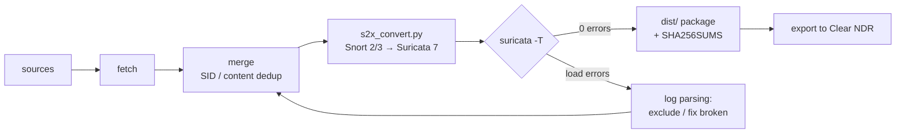

<p align="center">
  
</p>

# NDR Rules Hub

**[Русская документация → README.md](README.md)** · architecture: [architecture.md (rus)](architecture.md) · [architecture.en.md (eng)](architecture.en.md) · Clear NDR integration: [docs/clearndr-integration.md (rus)](docs/clearndr-integration.md) · [docs/clearndr-integration.en.md (eng)](docs/clearndr-integration.en.md)

A management service for **Snort / Suricata** rule sources with a full-featured Web UI, scheduled
automatic downloads, Snort 2/3 → Suricata conversion, deduplication, SID conflict resolution,
**validation of the final ruleset with the real Suricata engine**, and export into **Clear NDR**
(https://docs.clearndr.io). Delivered as a **Docker container**.

> Author and developer — **Pavel Kozhevatov** ([kozhevatov.ru](https://kozhevatov.ru)) ·
> repository: [github.com/NoIDXMV6/ndr-rules-hub](https://github.com/NoIDXMV6/ndr-rules-hub) ·
> acknowledgements to Clear NDR (Stamus Networks) and [mikrocata2selks](https://github.com/angolo40/mikrocata2selks) —
> see the “About” tab in the UI.

   

## Features

| Block | What it does |
|---|---|
| **Sources** | Catalog of 25 preconfigured sources (13 original from Clear NDR + 12 new). Add your own by URL/archive/local file. Types: ruleset, tar.gz archive, IP/domain/URL lists (converters) |
| **Fetching** | HTTP(S) with **oinkcode** support (snort.org, no login/password), auth-key, Basic. snort.org rate-limit handling (403 → a clear message). Local archives and directories |
| **Converters** | IP/CIDR lists → rules (chunks of N addresses per SID), domains → DNS rules, URLs → HTTP rules. SIDs from the private 1,000,000+ range |
| **Snort→Suricata converter** | `scripts/s2x_convert.py`: Snort 3 sticky buffers (http_uri…) → dot forms (http.uri…), inline content modifiers → separate keywords, bufferlen → bsize, soid/service removal, variable mapping, file→tcp, ssl→tls. Empirically calibrated on Suricata 7.0.10 |
| **Validator** | Every final ruleset is run through **real Suricata** (`suricata -T`); the “validate → parse log → fix/exclude → repeat” loop continues until 0 errors. **An unvalidated ruleset cannot reach Clear NDR** — export is blocked |
| **Deduplication** | By SID (strategies: highest rev / source priority / renumber into the private range) and by content (canonical SHA-1 without sid/rev/msg/metadata) |
| **Compatibility** | Automatic detection of Snort 2 (preproc, react, rawbytes…) and Snort 3 (keystore, pkt_trace…) keywords missing in Suricata, filtered out at build time |
| **Build** | A final `suricata.rules` file with a header, per-source statistics and SHA-256 |
| **Clear NDR export** | 1) file for manual import; 2) **native integration via the Clear NDR (Scirius) REST API** — upload + `update_push_all` with a token; 3) pull scheme: Clear NDR fetches the file from the Hub (`/api/export`) and updates itself on its own schedule; 4) HTTP POST to any endpoint; 5) copying to a shared directory (volume). Step-by-step guide — [docs/clearndr-integration.en.md](docs/clearndr-integration.en.md) |
| **WireGuard VPN** | Full setup: wg-quick config editor, syntax check, up/down, status (`wg show`), environment check (wg, wg-quick, /dev/net/tun, NET_ADMIN). Rule downloads through the tunnel |
| **Clear NDR update** | A tab that detects the installed version → finds the latest stamusctl-templates release → when a newer one exists, lets you pick options (OpenSearch/PostgreSQL data, backups, stamusctl CLI) and start the update in one click. The `clearndr-update.sh` script runs on the host (SSH, or local when the hub is deployed in a container on the Clear NDR host), the log streams in real time, failures trigger automatic rollback, and the result is verified (containers, web UI, REST API). v4: self-restore of a missing `config/docker-compose.yaml`, `docker compose config` validation, auto-patch of the `networks` section (a gap in the 3.3.x templates), backup gate and rollback guard. A separate `clearndr-repair-stack.sh` repairs a broken instance `config/`. Guide — [docs/clearndr-update.en.md](docs/clearndr-update.en.md) |
| **Schedule** | cron (node-cron): source update → build → export. Controlled from the UI |
| **Logs** | All fetch/build/export/VPN events with levels and filters |
| **Bilingual UI** | Russian and English via localization files (`src/lib/i18n/`). Language detected from browser strings (`navigator.languages`), RU/EN switch in the header, choice persisted in `localStorage`. Favicon (`public/favicon.ico`, 16–256 px) and logo included |
| **Help & “About”** | Tabs with goals/principles, developer info, acknowledgements and the technology list — collapsible accordions, also in both languages. The “Help” tab includes a detailed Clear NDR integration guide (token, PUSH/PULL schemes, auto-update) illustrated with process diagrams |

## Validated ruleset package for Clear NDR

The ready-made package is in the [`dist/`](dist/) directory and in the release attachments:

- **113,843 rules** from 13 sources (ET Open, Talos Snort 2.9 + Snort 3, Abuse.ch SSLBL,
  Phishing Army, PT Attack Detection, Quadrant, OISF Traffic-ID, Blocklist.de, CINS Army,
  Spamhaus DROP, Feodo Tracker);
- every file was checked with `suricata -T` on Suricata 7.0.10 — **0 load errors**;
- variants: `full` (the whole set), `starter` (53,674 rules, high signal), `smoke` (123),
  breakdowns by category (`by-category/`) and by source (`by-source/`);
- integrity control: `sha256sum -c SHA256SUMS.txt`.

Testing and import procedure — in [`dist/README-IMPORT.md`](dist/README-IMPORT.md).

### Compatibility results (Suricata 7.0.10, 120k-rule corpus)

| Ruleset | Loads as is | After the s2x converter |
|---|---|---|
| ET Open (suricata-7.0) | **100%** | — |
| Talos Snort 2.9 (snapshot-29200) | 99.93% | **100%** (minus 0.2% excluded by the validator) |
| Talos Snort 3 (snapshot-3200) | **1.5%** | **99.7%** |

Typical Snort 3 → Suricata 7 incompatibilities: sticky buffers before content (9,829 rules), `soid`
(4,584), the `file` protocol (1,387), `service` (782), inline content modifiers (~30k options),
`bufferlen` (1,061), `byte_math`, SIP buffers, the 8192-byte rule length limit.

## Quick start (Docker)

```bash
git clone <repo> ndr-rules-hub && cd ndr-rules-hub
cp .env.example .env
# put your Oinkcode in (snort.org profile → Oinkcode) — can also be done later via the UI
echo 'OINKCODE=your_code' >> .env

docker compose up -d --build
# UI: http://localhost:3080
```

First run: the **“Sources”** tab → enable the sources you need → “Refresh all” →
the **“Build & Export”** tab → “Build” → “Download final file” (import into Clear NDR
using Clear NDR itself), or configure automatic export in **“Settings”**
(the “Clear NDR REST” mode — see [docs/clearndr-integration.en.md](docs/clearndr-integration.en.md): token, commands, auto-update, mock test).

> **Oinkcode is enough**: the official way to automate snort.org registered-rule downloads is
> `/reg-rules/<file>/<oinkcode>` (a redirect to `/rules/<file>?oinkcode=…`). No login/password needed.
> Personal-cabinet links (`https://snort.org/downloads/registered/<file>.tar.gz`) do **not** accept an
> oinkcode query parameter — the Hub automatically rewrites them to the canonical reg-rules form.
> Mind the snort.org download limit — do not enable several mirrors of the same ruleset at once.

## Bilingual interface (RU/EN)

The UI is localized into two languages via localization files:

- **Language detection** — from the browser strings: `navigator.languages` (the first language a
  translation exists for; `ru-RU` → Russian, `en-US` → English). No server cookies needed: the
  page is fully client-side.
- **RU/EN switch** — in the header, on the right. The choice is stored in `localStorage`
  (key `ndrh.lang`) and takes priority over the browser on subsequent visits.
- **Dictionaries** — `src/lib/i18n/ru.ts` (canonical) and `src/lib/i18n/en.ts` (typed as
  `typeof ru`, so a missing key breaks `tsc`). Templates with variables: `'Built {n} rules'` +
  the `tr()` function. Rich text (bold/code) — lightweight `**…**` and `` `…` `` markup in the
  `Rich` component.
- **Provider** — `useSyncExternalStore` on top of localStorage: SSR always renders Russian,
  after hydration React switches to the browser language without hydration mismatches.
- All 9 tabs, the header, the footer, action messages, size units (B/KB) and date formats
  (`ru-RU`/`en-US`) are localized. Engine messages in the log and API errors are in Russian —
  those are operational data, not interface elements.

See also [architecture.md](architecture.md) (Russian) and [architecture.en.md](architecture.en.md)
(English) for the system architecture.

## Diagnostics (if the UI shows an API error)

The UI and the API are served by the same Next.js server: if the page opened, the backend is
reachable — there is no separate “backend” to expose. An `HTTP 500` error means the request
reached the API and the route crashed; the real cause is returned in the response, shown in the
red bar in the UI and duplicated into the container logs.

```bash
docker logs ndr-rules-hub --tail 100        # [entrypoint] …, [api] 500: <cause>
curl -s http://localhost:3080/api/health    # self-diagnostics: DB, schema, files
```

`/api/health` answers 200 even with a broken DB and shows the exact error (for example,
`PrismaClientKnownRequestError P2022` with an outdated schema). The DB schema is fixed
automatically: the entrypoint compares the version stamp (`/app/data/.schema-version`) with the
one from the image and, on mismatch, backs up the old DB to `./data/hub.db.bak-<date>` and
creates a new one.

The error `Prisma Client could not locate the Query Engine for runtime …` means the Prisma
platform mismatched between build stages (builder ≠ runtime). The repo already accounts for
this: `binaryTargets = ["native", "debian-openssl-3.0.x"]` in `prisma/schema.prisma` covers the
`node:22-bookworm-slim` runtime image. The schema version stamp is computed from models only,
so generator edits do not trigger a rebuild.

## Running without Docker

```bash
bun install
cp .env.example .env   # DATABASE_URL=file:./db/hub.db
bun run db:push
bun run dev            # http://localhost:3000
bunx vitest run        # engine tests
```

## Environment variables

| Variable | Purpose | Default |
|---|---|---|
| `OINKCODE` | oinkcode for snort.org (can be set in the UI) | — |
| `DATABASE_URL` | SQLite DB | `file:/app/data/hub.db` |
| `RULES_DATA_DIR` | data directory (cache, exports, archives) | `/app/data` |
| `WG_CONFIG_DIR` | where to store WireGuard configs | `/app/data/wireguard` |
| `TZ` | cron timezone | `Europe/Moscow` |

## WireGuard in the container

`docker-compose.yml` already contains `cap_add: NET_ADMIN`, the `/dev/net/tun` device and
`ip_forward`. The image ships `wireguard-tools` (wg + wg-quick), `iptables`, `iproute2`,
`openresolv` (the “DNS =” lines) and `procps`/`sysctl` (required for `AllowedIPs = 0.0.0.0/0`).
In the UI (the **WireGuard VPN** tab):

1. paste a `.conf` file (wg-quick format), optionally set the interface name with a
   `# InterfaceName: wg-office` comment;
2. “Check config syntax” → “Save” → “Bring tunnel up”;
3. handshake/traffic status is visible in the “Active interfaces” block.

If the tunnel should only serve snort.org downloads — restrict `AllowedIPs` to the snort.org
subnets instead of `0.0.0.0/0`.

### If the UI shows “No /dev/net/tun”

This warning does not affect rule downloads or builds — only tunneling. If you do not need the
VPN, it can be ignored. If you do:

1. **Check the host** (the machine running Docker):
   ```bash
   ls -l /dev/net/tun                     # must exist (character device 10,200)
   sudo modprobe tun                      # if missing — load the module
   sudo modprobe wireguard                # kernel module for the tunnels themselves
   echo tun | sudo tee /etc/modules-load.d/tun.conf   # and load at boot
   echo wireguard | sudo tee /etc/modules-load.d/wireguard.conf
   ```
   If the file is still missing after `modprobe tun`: `sudo mkdir -p /dev/net && sudo mknod /dev/net/tun c 10 200 && sudo chmod 666 /dev/net/tun`.
2. **Make sure the container runs the repository compose** (it has `cap_add` and `devices`):
   ```bash
   cd ndr-rules-hub && git pull && docker compose up -d --force-recreate
   docker inspect ndr-rules-hub --format '{{json .HostConfig.CapAdd}} {{json .HostConfig.Devices}}'
   # expected: ["NET_ADMIN"] [{"PathOnHost":"/dev/net/tun",...}]
   ```
   If it shows `[]` — the container was started via `docker run` or an old compose without these
   flags: recreate it with the repository `docker-compose.yml` (for `docker run` add
   `--cap-add NET_ADMIN --device /dev/net/tun`).
3. **Check inside the container**: `docker compose exec rules-hub test -e /dev/net/tun && echo OK`.
4. **The host is an LXC container (Proxmox etc.)**: tun must be allowed on the hypervisor —
   add to `/etc/pve/lxc/<id>.conf` and restart the LXC:
   ```
   lxc.cgroup2.devices.allow: c 10:200 rwm
   lxc.mount.entry: /dev/net/tun dev/net/tun none bind,create=file
   ```

### If wg-quick fails with “sysctl: permission denied on key”

For full-tunnel configs (`AllowedIPs = 0.0.0.0/0`) wg-quick sets
`net.ipv4.conf.all.src_valid_mark=1`, but `/proc/sys` is read-only inside the container
(especially on 6.8+ kernels), so the write is denied even with NET_ADMIN. Two steps are needed:

1. **The value must be set by docker at container creation** — the repository
   `docker-compose.yml` already contains:
   ```yaml
   sysctls:
     - net.ipv4.ip_forward=1
     - net.ipv4.conf.all.src_valid_mark=1
   ```
   Recreate the container: `git pull && docker compose up -d --build --force-recreate`.
2. **wg-quick in the image is patched** as in upstream wireguard-tools (commit `ac74ed6`):
   the write happens only if the value is not already 1. The stock bookworm version
   (1.0.20210914) wrote unconditionally and failed on read-only `/proc/sys` even when the
   value was already set — the patch fixes that.

Check: `docker compose exec rules-hub sysctl -n net.ipv4.conf.all.src_valid_mark`
should print `1`; the “src_valid_mark (write)” card in the UI turns green.

If `docker compose up` itself fails to set this sysctl (happens inside an unprivileged LXC) —
set the key on the host/LXC (`sysctl -w net.ipv4.conf.all.src_valid_mark=1`) and add it to
`/etc/sysctl.conf`; or run the LXC in privileged mode. An alternative without sysctl: restrict
`AllowedIPs` to the snort.org subnets — wg-quick then does not touch that key.

### If the web UI is unreachable while a full-tunnel is up

Symptoms: the tunnel is up, handshake present (`docker compose exec rules-hub wg show`),
but the Hub page does not open, and in an open tab all environment-check cards show “no data”.
The cause is the very nature of full-tunnel: wg-quick adds policy routing
(`ip rule not fwmark → table 51820`) which wraps EVERYTHING into the tunnel, including reply
packets of incoming connections to the web UI (port mapping 3080→3000): replies go out via wg0
and get lost.

The Hub solves this automatically: when a full-tunnel config comes up it adds the rule

```bash
ip rule add from <container-address-on-eth0> lookup main priority 100
```

(and the same for global IPv6 if present) — web UI replies go out via eth0 while all other
outbound container traffic goes through the tunnel. The rule is removed on “Bring tunnel down”.
Verify with:

```bash
docker compose exec rules-hub ip rule show          # a “100: from <IP> lookup main” line
```

Emergency access recovery (when the UI is already “dead” and buttons cannot be pressed) —
from the host:

```bash
# option 1: bring the tunnel down properly
docker compose exec rules-hub wg-quick down /app/data/wireguard/wg0.conf
# option 2: if that did not help — delete the interface directly
docker compose exec rules-hub ip link del wg0
# option 3: the simplest one — restart the container (the tunnel goes down too)
docker compose restart rules-hub
```

### If rule downloads fail with “HTTP 422” (snort.org)

Verified in practice: snort.org answers `HTTP 422` with the body `["Invalid oinkcode"]` when the
**oinkcode is not accepted** — the code is missing, has a typo, or was revoked. Since this
version the Hub shows the response body and a fingerprint of the submitted code
(`sent oinkcode abcd…ef01 (40 chars)` or `oinkcode NOT set`) in the error, so the cause is
immediately visible. What to check:

1. the code is saved in **Settings** (the oinkcode field) or in the source extra;
2. the code is copied in full from snort.org → **Preferences → Oinkcode** (40 hex characters,
   no spaces or line breaks);
3. the snort.org account is active and the code is not revoked (re-issue it if in doubt);
4. if the code is definitely correct but 422 keeps repeating — note that with a full-tunnel up,
   requests to snort.org come from the VPN server IP: temporarily bring the tunnel down
   (“Bring down” in the WireGuard tab) and retry “Refresh” — this rules out snort.org reacting
   to the egress IP.

For reference: `403` — wrong oinkcode or the download limit (registered — no more than once
every 15 minutes), `429` — too frequent requests. The Hub does not re-download the archive if
`cacheTtlMinutes` is set in the source extra (an archive younger than N minutes is taken from
the cache), and when a source is unreachable it automatically works from the previously
downloaded archive, noted in the logs.

### If unpacking fails: “tar: … not in gzip format”

Previously the Hub stored an HTTP 200 body as is: if snort.org returned an HTML page instead of
an archive (download limit, a personal-cabinet link with the oinkcode in the query — verified:
`downloads/registered/…?oinkcode=` returns a web page, not an archive), the file was written as
`.tar.gz` and tar failed with an opaque error. Starting with this version:

1. **Magic-byte check** — the archive is only stored and unpacked if the body starts with
   `1f 8b` (real gzip); otherwise the error shows the HTML page title and a hint
   (limit / link form / oinkcode).
2. **Link normalization** — personal-cabinet links
   (`snort.org/downloads/registered|subscribed/<file>.tar.gz`) are automatically rewritten to the
   canonical `www.snort.org/reg-rules/<file>.tar.gz/<oinkcode>` form — both work, no need to
   change the URL in the source.
3. **The cache stays clean** — HTML is no longer saved over a previously downloaded archive;
   on a bad response the Hub works from the cache with a warning.
4. tar errors are now short (“archive downloaded (N bytes), but tar could not unpack it: …”)
   instead of `Command failed: tar -xzf /app/data/cache/…`.

## Service API

| Method/path | Description |
|---|---|
| `GET /api/health` | self-diagnostics: DB, schema version, files (always 200) |
| `GET /api/dashboard` | summary: sources, rules, latest build, VPN, logs |
| `GET/POST /api/sources` | list / add a source |
| `PATCH/DELETE /api/sources/:id` | edit / delete |
| `POST /api/sources/:id/fetch` | fetch the source’s rules |
| `POST /api/fetch-all` | update all enabled |
| `POST /api/build` | build `{ "export": true }` — with export |
| `GET /api/export` | download the final file |
| `POST /api/export` | push to Clear NDR using the configured method |
| `GET /api/rules?sid=&q=&sourceId=&page=` | browse the rule database |
| `GET/PUT /api/settings` | settings (oinkcode, policies, cron, export) |
| `GET/POST/PUT/DELETE /api/vpn` | WireGuard status/actions/profiles |
| `GET /api/clearndr-update` | update section status: versions, host preflight, stack state, run history (`?log=<runId>` — run log) |
| `POST /api/clearndr-update` | actions: `probe` (host check), `start` (begin update), `cancel`, `sync-script` |
| `PUT /api/clearndr-update` | connection settings (SSH/local, instance dir, URL, token) |
| `GET /api/logs` | log |

## Structure

```
prisma/schema.prisma        # Source, Rule, Build, Setting, LogEntry, VpnProfile
src/lib/engine/
  parser.ts                 # Snort2/Snort3/Suricata rule parser (+multiline)
  convert.ts                # IP/domain/URL → rule converters
  fetcher.ts                # fetching (url/tarball/local, oinkcode/auth-key/basic)
  build.ts                  # mergeSources: SID/content dedup, renumbering
  exporter.ts               # file · Clear NDR REST (upload → apply) · HTTP POST · directory
  vpn.ts                    # wg-quick: config, up/down, status, environment check
  service.ts                # orchestration: fetch → build → export, cron, catalog seed
  seed.ts                   # catalog of 25 sources + default settings
src/lib/i18n/
  detect.ts                 # Lang type, detectLang (browser strings), tr(), localeOf
  ru.ts / en.ts             # UI dictionaries (en is typed as Dictionary = typeof ru)
  index.tsx                 # I18nProvider (useSyncExternalStore) + useI18n()
scripts/
  s2x_convert.py            # Snort 2/3 → Suricata 7 converter (probe-calibrated)
  talos_convert_batch.py    # batch Talos 29200/3200 conversion + validation
  final_assembly.py         # package assembly: merge + suricata -T loop until 0 errors
  keyword_analysis.py       # analysis of 153 corpus keywords
  make_final_files.py       # delivery files (full/starter/smoke/by-*)
  clearndr-check.sh         # Clear NDR REST API check (token, sources, rulesets)
  clearndr-setup-pull.sh    # pull scheme setup: Hub-URL source + ruleset + schedule
  clearndr-push.sh          # push delivery of a .rules file to Clear NDR (cron-friendly)
  clearndr-update.sh        # in-place Clear NDR stack upgrade (backups + rollback + config/ v4 safeguards)
  clearndr-repair-stack.sh  # repair a broken instance config/ (missing compose file, networks section)
  clearndr-mock-server.py   # Clear NDR mock (Scirius REST) for integration testing
  make-favicon.mjs + make-favicon-ico.py  # favicon.ico from public/logo.svg (sharp + ICO)
docs/
  clearndr-integration.md / .en.md  # exact guide to delivering and auto-updating rules to Clear NDR
  clearndr-update.md / .en.md       # guide to upgrading the Clear NDR stack with all settings preserved
dist/                       # VALIDATED package for Clear NDR (zip + README + SHA256)
src/app/api/…               # REST API (Next.js route handlers)
src/components/hub/…        # Web UI (9 tabs, bilingual)
public/logo.svg, public/favicon.ico  # logo and favicon
architecture.md / .en.md     # system architecture (rus/eng)
tests/                      # vitest: parser, converters, build, VPN, fetcher, i18n
Dockerfile                  # multi-stage build (standalone + wireguard-tools)
docker-compose.yml          # NET_ADMIN, /dev/net/tun, volume ./data
```

### Ruleset quality pipeline



The full description of the quality gates is in [architecture.en.md, section 5](architecture.en.md#5-rules-quality-pipeline).

Running the pipeline manually (in a sandbox without Docker):
```bash
python3 scripts/talos_convert_batch.py   # Talos 29200+3200 → Suricata
python3 scripts/final_assembly.py        # the whole corpus + the validation loop
python3 scripts/make_final_files.py      # delivery files into download/rules/
```

## Tests

```bash
bunx vitest run
```

84 tests (9 files): parsing real Snort 3 rules (multiline, pcre with braces), converters
(IP chunks, domains, URLs, maxRules guards), SID deduplication strategies, renumbering,
DELETED stubs, content hash, wg-quick configs (valid/broken), local directory and tar.gz
fetching, an online list-converter integration test (Spamhaus DROP), plus the i18n suite:
browser-string language detection, template interpolation, full ru/en key parity, `{n}`
placeholder parity across languages, localized size units.

## Source catalog — analysis

See [docs/ANALYSIS.md](docs/ANALYSIS.md): a full breakdown of the 5 snort.org archives from
Yandex.Disk (real SID overlaps), verdicts on duplicates, Suricata compatibility and a review of
all available rule sources with working URLs.
