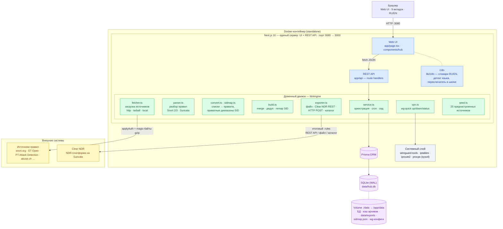
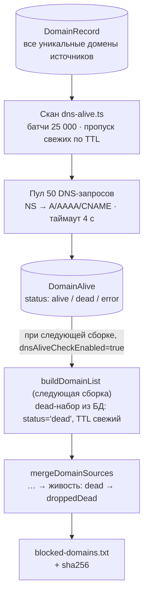
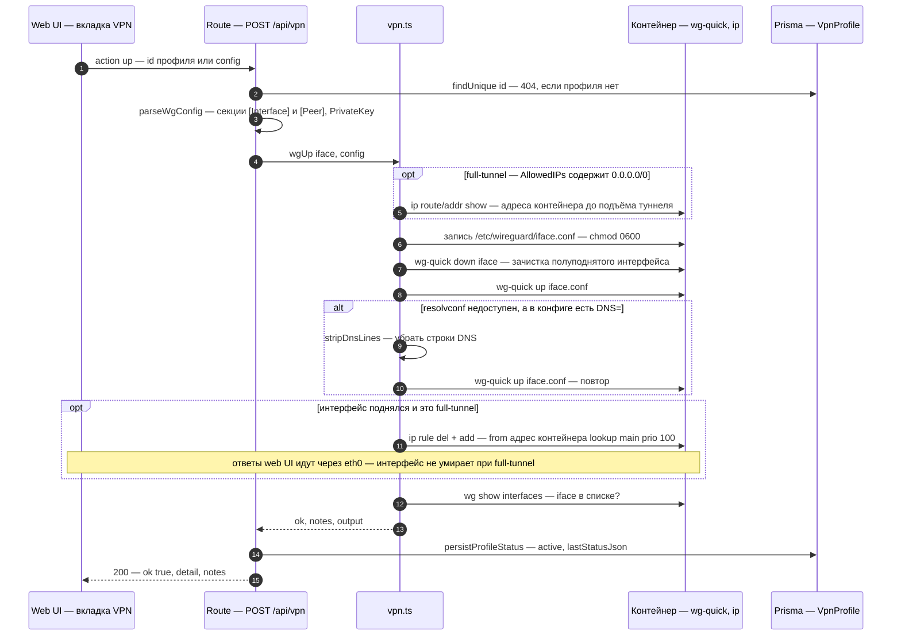
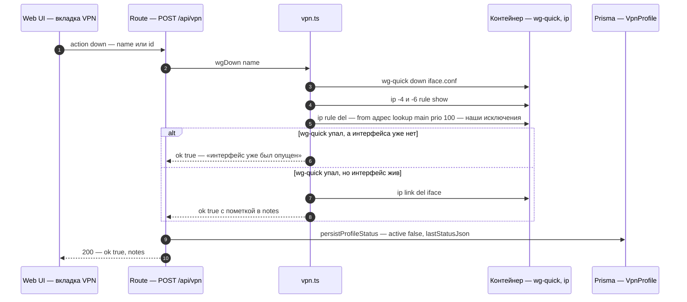
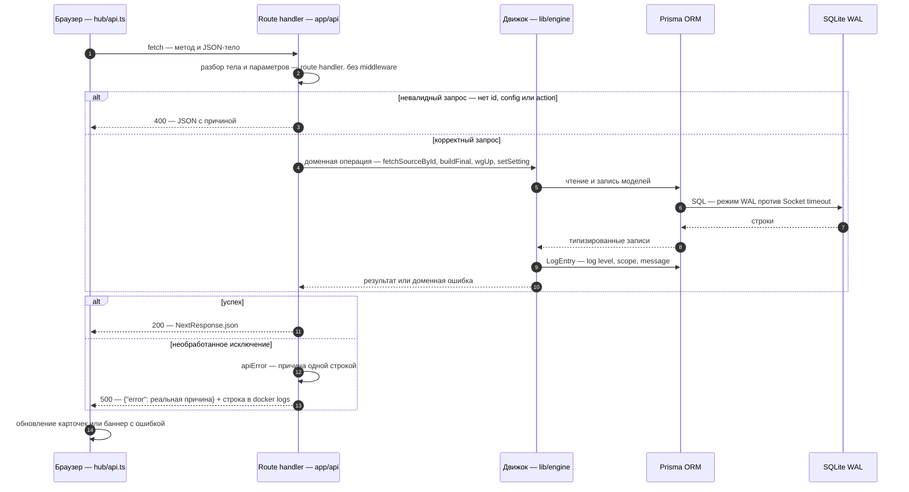
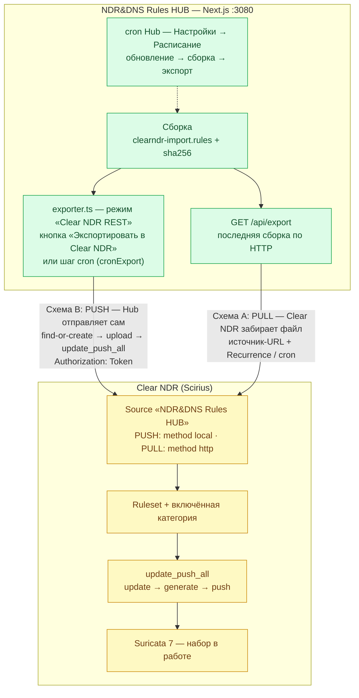
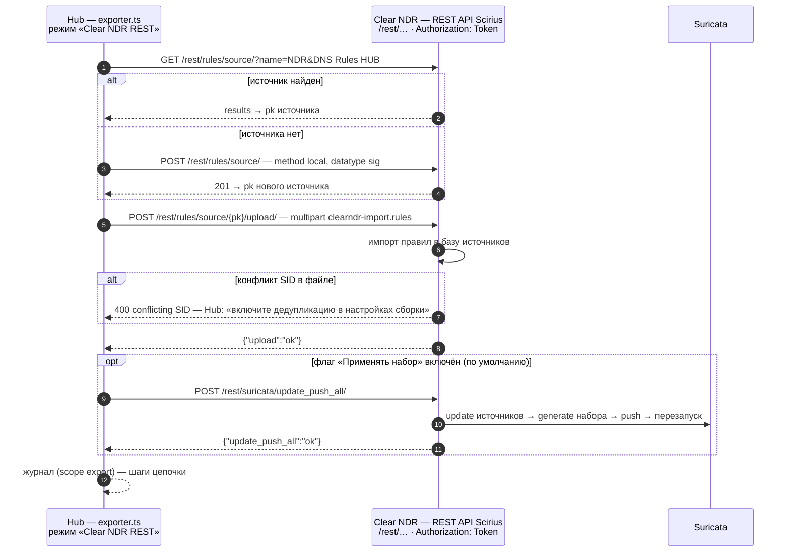
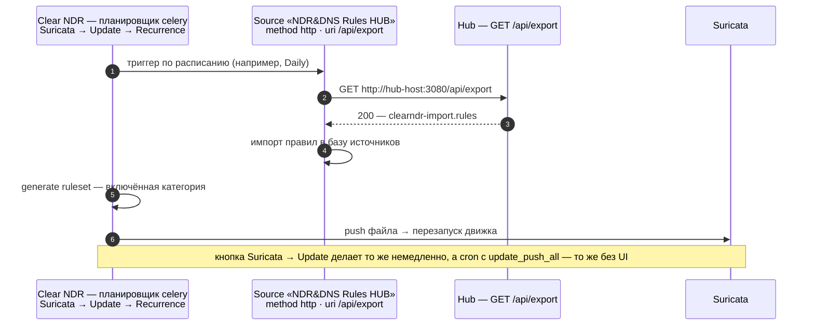

<p align="center">
  
</p>

# Архитектура NDR&DNS Rules HUB

**English version → [architecture.en.md](architecture.en.md)** · README: [README.md](README.md) · [README.en.md](README.en.md)

Документ описывает устройство системы: компоненты, модель данных, конвейеры обработки
и качества правил, механику загрузки, дедупликации и экспорта, интеграцию с Clear NDR,
VPN-слой, интерфейс и локализацию.

---

## 1. Обзор и назначение

**NDR&DNS Rules HUB** — вспомогательный сервис для NDR-платформы **Clear NDR** (Stamus Networks,
Suricata-базированной). Задача: автоматизировать полный цикл работы с наборами правил
Snort/Suricata — от источников до итогового файла, готового к импорту в Clear NDR.

Ключевые проблемы, которые закрывает система:

- **разрозненные источники** — официальные наборы Talos (snort.org), ET Open, PT Attack Detection,
  Quadrant, OISF, фиды abuse.ch и десятки конвертеров списков индикаторов живут по разным URL,
  с разной авторизацией и лимитами;
- **дубликаты и конфликты SID** — главная причина отказов импорта в Clear NDR
  («conflicting sid»);
- **несовместимость Snort → Suricata** — синтаксис Snort 3 (sticky-буферы, `soid`, `file`,
  inline-модификаторы) ломает загрузку в Suricata;
- **ручной труд** — без сервиса обновление правил — это ручное скачивание, конвертация и
  проверка по расписанию.

Принцип надёжности: **невалидированный набор не может попасть в Clear NDR** — итоговый файл
прогоняется через реальный движок Suricata (`suricata -T`), и экспорт блокируется до нуля ошибок.

Доставка набора в Clear NDR тоже автоматизирована: **PULL** (Clear NDR сам забирает файл с Hub
по расписанию) или **PUSH** (Hub отправляет сам через REST API Scirius по токену). Пошаговая
инструкция с командами — [docs/clearndr-integration.md](docs/clearndr-integration.md),
архитектура интеграции — раздел 12.

## 2. Компонентная схема



Сервер один: Next.js обслуживает и UI, и API. «Бэкенда» отдельно не существует — если страница
открылась, API доступен. Данные переживают пересоздание контейнера за счёт volume `./data`.

## 3. Модель данных (Prisma / SQLite)

Схема — `prisma/schema.prisma`. Клиент генерируется с `binaryTargets = ["native",
"debian-openssl-3.0.x"]` (builder `oven/bun` ≠ runtime `node:22-bookworm-slim`).

| Модель | Назначение | Ключевые поля |
|---|---|---|
| `Source` | источник правил | `category` (ruleset / ip-list / domain-list / url-list / hash-list), `kind` (url / tarball / local), `authType` (none / oinkcode / authkey / basic / misp / opennrd / rstkey), `extraJson` (параметры конвертера и авторизации), `priority` (меньше = главнее), `status`, `badge`, `builtin` |
| `Rule` | правило конкретного источника | `sid`, `rev`, `action`, `proto`, `msg`, `raw`, `contentHash` (канонический SHA-1 без sid/rev/msg/metadata), `suricataOk`, `compatNotes`; уникальность `[sourceId, sid]` |
| `Build` | результат сборки | `statsJson` (статистика по источникам/дубликатам), `policyJson` (применённые политики), `fileName`, `sha256`, `sizeBytes`, `source` (manual / cron) |
| `Setting` | настройки (k-v) | oinkcode, стратегии дедупликации (победитель/проигравший), cron, параметры экспорта |
| `LogEntry` | журнал событий | `level` (ok/warn/error/success), `scope`, `message` |
| `VpnProfile` | сохранённый wg-quick конфиг | `name`, `config`, `active`, `lastStatusJson` |

Надёжность БД: режим **WAL** (против «Socket timeout» при параллельных запросах),
**два клиента** Prisma (v1.35.0): `db` — интерактивный (API интерфейса), `dbHeavy` —
тяжёлые операции (сборки правил/DNS, импорт дампа, массовые вставки): в WAL читатели
не блокируют друг друга — интерфейс отвечает во время сборки; длинные операции
разряжают event loop (батчи с паузами), сортировка миллионов строк — чанковая
(k-way слияние), файл сборки пишется стримингово, «зависшая» сборка (нет признаков
жизни 10 минут) принудительно завершается watchdog-ом, счётчики дашборда кэшируются
(TTL 60 с, фоновое обновление) и каждое событие сборки дублируется в stdout контейнера,
и
авто-восстановление схемы: entrypoint сверяет штамп версии (`/app/data/.schema-version`) с
образцом из образа; при несовпадении старая база бэкапится в `data/hub.db.bak-<дата>` и
создаётся новая. Штамп считается только по моделям, поэтому правки генератора не пересоздают БД.

## 4. Конвейер обработки правил

```mermaid
flowchart LR
    subgraph SRC["Источники — 25 преднастроенных + свои"]
        direction TB
        SRC1["ruleset / tarball<br/>snort.org · ET Open ·<br/>PT AD · abuse.ch"]
        SRC2["локальные файлы<br/>и каталоги"]
        SRC3["списки индикаторов<br/>ip · domain · url"]
    end

    subgraph FETCH["Загрузка — fetcher.ts"]
        direction TB
        AUTH["applyAuth():<br/>oinkcode → reg-rules/файл/code,<br/>authkey · basic"]
        CHECK{"HTTP 200<br/>и gzip 1f 8b?"}
        CACHE[("кэш архивов<br/>data/cache<br/>cacheTtlMinutes")]
    end

    PARSE["Парсинг — parser.ts<br/>заголовок + опции, многострочные,<br/>pcre со скобками"]
    CONV["Конвертация — convert.ts · sidmap.ts<br/>IP-чанки · домены · URL,<br/>SID-блок 1 100 000+, предохранители"]

    RULES[("Prisma · Rule — по источнику<br/>sid · rev · raw · contentHash<br/>suricataOk · compatNotes")]

    subgraph BUILD["Сборка — build.ts · service.ts"]
        direction TB
        MERGE["mergeSources(): конфликт SID →<br/>highest-rev / source-priority ·<br/>проигравший: drop/reassign · dropIncompatible"]
        CONTENT["content-дедуп: SHA-1<br/>без sid/rev/msg/metadata/reference"]
        REMAP["remapToClearndrBlock():<br/>SID → свободный блок 1e9+,<br/>общая карта sidmap.json"]
        GATE{"гейт Clear NDR:<br/>конфликтные близнецы?"}
    end

    FINAL["renderFinalFile():<br/>clearndr-import.rules,<br/>sha256 + запись Build"]
    VALID["Валидация: статический фильтр<br/>совместимости (suricataOk);<br/>офлайн-пакет — цикл suricata -T"]
    EXPORT["Экспорт — exporter.ts<br/>файл · Clear NDR REST (Token) ·<br/>HTTP POST · каталог volume"]
    CRON["cron — node-cron<br/>обновление → сборка → экспорт<br/>(+ DNS-цикл: inline или отдельное расписание)"]
    LOG["LogEntry: error —<br/>сборка прервана"]

    SRC1 --> AUTH
    SRC2 --> AUTH
    SRC3 --> AUTH
    AUTH --> CHECK
    CHECK -- "да: текст правил" --> PARSE
    CHECK -- "да: список ip/domain/url" --> CONV
    CHECK -- "нет: HTML, лимит, ошибка" --> CACHE
    CACHE -- "fallback: ранее скачанный архив" --> PARSE
    PARSE --> RULES
    CONV --> RULES
    RULES --> MERGE
    MERGE --> CONTENT
    CONTENT --> REMAP
    REMAP --> GATE
    GATE -- "нет: 0 близнецов" --> FINAL
    GATE -- "да" --> LOG
    FINAL --> VALID
    VALID --> EXPORT
    CRON -.-> FETCH
    CRON -.-> BUILD
```



Шаги:

1. **Загрузка (`fetcher.ts`)** — по `kind`: HTTP(S)-URL, tar.gz-архив (скачивание → проверка
   magic-байтов → `tar -xzf` → сбор всех `.rules`), локальный путь/каталог.
2. **Парсинг (`parser.ts`)** — разбор заголовка и опций правила в структуру (SID, rev, msg,
   classtype, proto, направление), поддержка многострочных правил и pcre со скобками.
3. **Конвертация списков (`convert.ts`, `sidmap.ts`)** — IP/CIDR чанками по N адресов на SID,
   домены → DNS-правила, URL → HTTP-правила; SID из блока 1 100 000+; предохранители
   `perRule`/`maxRules`.
4. **Дедупликация и сборка (`build.ts`)** — устранение дубликатов по SID и по содержимому,
   разрешение конфликтов SID (победитель — стратегией, проигравший — политикой
   drop/reassign); фильтр совместимости.
5. **Валидация** — конвертер `scripts/s2x_convert.py` + цикл `suricata -T` (для офлайн-пакета
   `dist/`; онлайн-сборка применяет статический фильтр совместимости).
6. **Экспорт (`exporter.ts`)** — пять режимов: файл для ручного импорта; **Clear NDR REST** —
   нативная интеграция (найти/создать источник → multipart-upload → `update_push_all`,
   авторизация `Authorization: Token`); HTTP POST на произвольный эндпоинт (Token/Bearer);
   копирование в каталог (общий volume); отключено. Детали — раздел 12.

## 5. Конвейер качества правил

Принцип системы: **невалидированный набор не может попасть в Clear NDR**. Качество
обеспечивается пятью гейтами — каждый блокирует дефектный материал на своём этапе.

```mermaid
flowchart TD
    subgraph G1["Гейт 1 — Загрузка · fetcher.ts"]
        direction TB
        A1{"HTTP 200?"}
        A2{"тело = gzip 1f 8b?"}
        A3[("кэш архива<br/>+ cacheNote в журнал")]
        A1 -- "нет" --> A3
        A2 -- "нет: HTML-страница лимита<br/>или личного кабинета" --> A3
        A1 -- "да" --> A2
    end

    subgraph G2["Гейт 2 — Парсинг и совместимость · parser.ts"]
        direction TB
        B1{"строка = правило<br/>(заголовок + опции)?"}
        B2{"checkSuricataCompat():<br/>preproc · react · resp · rawbytes ·<br/>asn1 · dce_* · activate/dynamic ·<br/>sticky-буферы Snort 3?"}
        BN["suricataOk = false<br/>compatNotes"]
        B1 -- "да" --> B2
        B2 -- "несовместимо" --> BN
    end

    subgraph G3["Гейт 3 — Хранение · service.ts"]
        direction TB
        C1["дедуп по SID внутри источника —<br/>остаётся максимальный rev"]
        C2["contentHash: канонический SHA-1<br/>без sid/rev/msg/metadata/reference"]
        C1 --> C2
    end

    subgraph G4["Гейт 4 — Сборка · build.ts"]
        direction TB
        D1["политики: dropDisabledMsg ·<br/>dropIncompatible · content-дедуп"]
        D2["конфликт SID → победитель:<br/>highest-rev / source-priority ·<br/>проигравший: drop/reassign"]
        D3["remap в свободный clearndr-блок<br/>1 000 000 000+ — карта sidmap.json,<br/>формула md5 общая с python-конвейером"]
        D4{"конфликтные близнецы —<br/>совпадают после снятия<br/>sid и reference:*?"}
        D1 --> D2
        D2 --> D3
        D3 --> D4
    end

    G5{"Гейт 5 — Валидация движком<br/>suricata -T · офлайн-пакет dist/<br/>цикл: разбор лога →<br/>исключение/исправление → повтор"}
    FAIL["СБОРКА ПРЕРВАНА — файл не пишется,<br/>LogEntry: error"]
    OK["итоговый файл: 0 дубликатов,<br/>0 конфликтов SID, 0 ошибок Suricata<br/>+ sha256 и статистика в Build"]
    EXPORT["экспорт в Clear NDR разрешён"]

    G1 --> G2
    G2 --> G3
    G3 --> G4
    D4 -- "да" --> FAIL
    D4 -- "нет" --> G5
    G5 -- "0 ошибок" --> OK
    OK --> EXPORT
```



Что делает каждый гейт:

1. **Загрузка** — плохой ответ не сохраняется как архив: magic-байты gzip проверяются до записи
   на диск (HTML-страница лимита больше не ломает tar «not in gzip format»); при неудаче работа
   продолжается от ранее скачанного кэша с явной пометкой в журнале.
2. **Парсинг и совместимость** — правило разбирается только если строка совпала с шаблоном
   заголовка; несовместимые с Suricata конструкции помечаются `suricataOk = false` с перечнем
   причин в `compatNotes` (не молча отбрасываются).
3. **Хранение** — внутри источника остаётся только максимальный `rev` каждого SID; содержимое
   канонизируется (SHA-1 без sid/rev/msg/metadata/reference) для последующего content-дедупа.
4. **Сборка** — политики из настроек, разрешение конфликтов SID по стратегии, перенос SID в
   свободный clearndr-блок; **гейт конфликтных близнецов**: пары, совпадающие после снятия
   `sid` и `reference:*`, роняют импорт Clear NDR («conflicting SID in same source»), поэтому
   при их обнаружении сборка падает целиком — плохой файл не записывается.
5. **Валидация движком** — офлайн-пакет `dist/` проходит цикл `suricata -T` → разбор лога →
   исключение/исправление битых правил → повтор **до нуля ошибок**; онлайн-сборка применяет
   статический фильтр совместимости. Экспорт возможен только из набора, прошедшего гейты.

## 6. Загрузка: авторизация и лимиты snort.org

`fetcher.ts` поддерживает `authType`: `none`, `oinkcode`, `authkey` (query-параметр), `basic`, `misp` (Authorization), `opennrd` (сегмент пути), `rstkey` (RST Cloud — заголовок X-Api-Key)
(логин/пароль в `extraJson`).

Проверено на практике поведение snort.org:

- каноническая форма авторизации — путь, а не query:
  `https://www.snort.org/reg-rules/<файл>.tar.gz/<oinkcode>` → редирект на реальный файл;
- ссылки личного кабинета `snort.org/downloads/registered/<файл>.tar.gz?oinkcode=…`
  **игнорируют query** и возвращают HTTP 200 + HTML-страницу;
- `applyAuth()` автоматически приводит любые известные формы к канонической
  (`downloads/registered|subscribed/…` → `reg-rules/<файл>/<oinkcode>`);
- **magic-байты gzip** (`1f 8b`) проверяются до записи на диск: HTML больше не сохраняется как
  архив и не ломает tar («not in gzip format»); при плохом ответе используется ранее скачанный
  архив (кэш) с пометкой `cacheNote`;
- лимиты: registered — не чаще раза в 15 минут; `cacheTtlMinutes` в `extraJson` исключает
  перекачивание; `422` = Invalid oinkcode, `403`/`429` = лимит; oinkcode в сообщениях об ошибках
  фигурирует только в виде отпечатка (`abcd…ef01`), полный код не логируется.

## 7. Дедупликация и стратегии SID

| Политика | Что делает |
|---|---|
| `dedupSidStrategy = highest-rev` | при конфликте SID остаётся правило с максимальным `rev` (по умолчанию) |
| `dedupSidStrategy = source-priority` | выигрывает источник с меньшим числом `priority` |
| `dedupSidConflict = reassign` | проигравший при конфликте SID с другим детектом остаётся в сборке с новым детерминированным SID (блок 2e9 → remap в clearndr-блок) |
| `dedupContent = true` | удаляет правила с одинаковым `contentHash` (канонический SHA-1 без sid/rev/msg/metadata), но разными SID |
| `dropIncompatible = true` | не включает в сборку конструкции, несовместимые с Suricata (preproc, keystore, replace, rawbytes…) |
| `dropDisabledMsg = true` | удаляет заглушки DELETED/DISABLED |

Статистика каждого шага (по источникам: загружено/в сборке/сброшено по SID/по содержимому/
несовместимых) пишется в `Build.statsJson` и отображается во вкладке «Сборка и экспорт».

## 8. DNS-фильтрация: доменные списки (v1.29.0)

Отдельный контур с идеологией, аналогичной правилам: источники → записи → сборка → отдача.
Меню **«DNS списки»** (администратор) с подменю второго уровня, зеркальным «Правилам»:
Источники / Категории / Записи (поиск, дубликаты, ручные решения) / Сборка и экспорт.

| Политика/сущность | Что делает |
|---|---|
| `DomainSource` | источник доменных списков: хостлисты (adguard `||домен^` / hosts / plain), каталог 46 списков AdGuard HostlistsRegistry + импортированная SQL-база; `purpose`: block / allow (белый список) |
| `DomainRecord` | домен конкретного источника; `mode`: block / allow (строки `@@` хостлистов); `categories` — ids категорий SQL-базы через запятую |
| `DomainCategory` | категории сборки: ключи каталога (ads/malware/phishing/…) + категории дампа `ifaro:<номер>:<Eng>` (у домена их может быть несколько — он остаётся в сборке, пока включена хотя бы одна) |
| `DomainOverride` | ручное решение по домену: исключить из сборки / принудительный блок поверх белого списка |
| `DomainBuild` | результат сборки: файл списка + sha256 + статистика |
| Слияние (`dns.ts mergeDomainSources`) | источники по возрастанию `priority`: домен достаётся первому, у остальных — дубликат; белый список применяется в конце; записи ленивые (AsyncIterable из курсора БД — миллионы строк без нагрузки на память) |
| RST Threat Feed (`rst.ts`) | доменный фид RST Cloud: gzip-CSV → колонка `domain` (фильтры `skipFpAlarm`/`minScore` из extra источника), далее обычный разбор; ключ `rstApiKey` — из «Токенов источников», подстановка в памяти (в БД секрет не пишется). Три NDR-фида (IP/URL/SHA-256) конвертируются как ip/url/hash-списки; проверка индикатора — `POST /api/rst/lookup` (IoC / Noise / Whois), проверка ключа — `POST /api/rst/check` |
| Импорт дампа (`dns-import.ts`) | потоковый разбор export.sql (MariaDB/HeidiSQL): 502 МБ → ~2,2 млн доменов и 151 категория без загрузки в память (~22 с); счётчики категорий кэшируются в настройке `dnsIfaroCategoryCounts` |
| Конвертация дампа → NDR | прочие типы resource дампа не теряются: **URL** — хост попадает в DNS-список (с категориями), сам URL — HTTP-правило; **IP/CIDR** — IP-правила чанками по 500 (drop ip, SID 1 200 000+); **Regex** — pcre на `http.uri.raw` (SID 1 400 000+, валидация компиляции и защита от слишком широких шаблонов); **Phrase** — `http.response_body` content (SID 1 500 000+). Правила пишутся в `data/domains/ndr/*.rules` и регистрируются ВЫКЛЮЧЕННЫМИ источниками «Дамп фильтрации: …» (правила загружаются в БД сразу — счётчик честный, в сборку попадают только после включения) |
| Сборка (`buildDomainList`) | 4 формата файла: plain / hosts (`0.0.0.0 d`) / dnsmasq (`address=/d/`) / adblock (`||d^`); прогресс — отдельный singleton (dns-progress.ts). Вкладка «Сборка и экспорт» зеркальна «Сборке итогового набора» правил: кнопка в шапке, настройки файла, прогресс с фазой и терминальным журналом, бейджи последней сборки, сетка показателей (вход/дубликаты/белый список/категории/вручную/TLD/итог), таблица по источникам, файлы каталога `data/exports/domains` (GET /api/dns/build отдаёт сборку и список файлов) |
| Отдача | `GET /api/dns/export` — БЕЗ ТОКЕНА ЗАПРЕЩЕНА: персональный токен скачивания со scope «domains»/«both» (полный Uri `?token=ndrt_…`) или сессия кабинета; глобальный ключ `dnsServeToken` удалён (v1.34.0), токены управляются только в «Аккаунте» |
| DNS-цикл (`dnsCycleMode` / `runDnsCycle`) | три режима: `inline` — сразу за основным циклом (`runPipeline`); `deferred` — по отдельному расписанию `dnsCronSchedule` (вторая cron-задача планировщика — разнос пиков: правила утром, домены позже); `off` — выключен `dnsCronEnabled`. Неверное выражение — журнал-предупреждение и откат к `inline` |
| Уведомление DNS-цикла | при `deferred` цикл шлёт СОБСТВЕННОЕ уведомление Telegram/Gotify (scope `dns`, строка «DNS-списки», переключатель `notifyOnDns` в «Интеграциях»): итоги обновления источников и сборки списка; при `inline` итоги DNS входят в уведомление полного цикла (строка «DNS: …») |
| Живость доменов (`dns-alive.ts`, v1.37.0) | проверка делегирования доменов из `DomainRecord` (не из итогового файла): `resolveNs` → при NXDOMAIN `resolve4/6/CNAME` параллельно; вердикты `alive / dead / error` пишутся в `DomainAlive` (upsert батчами) и применяются СЛЕДУЮЩЕЙ сборкой — детали в 8.1 |
| API живости | `GET /api/dns/alive` — настройки `dnsAlive*`, прогресс скана, счётчики вердиктов (кэш 60 с); `POST /api/dns/alive {action:"start"|"cancel"}` — ручной запуск/отмена (только администратор: скан шлёт массовые DNS-запросы наружу) |

### 8.1 Проверка живости доменов (v1.37.0)

В хостлистах копятся неделегированные домены (не продлены, удалены, зарезервированы
регистратурой) — они бесполезны в итоговом списке, но раздувают сборку и память
DNS-сервера. Механика:



1. **Откуда домены.** Скан берёт домены НЕ из итогового файла, а из БД: курсор по
   `DomainRecord` (`SELECT DISTINCT domain … ORDER BY domain LIMIT 25000`) — то есть
   проверяются все сырые домены всех включённых источников, включая те, что дальше
   отсеются слиянием.
2. **Классификация.** `NS` отвечает → alive; иначе параллельно `A/AAAA/CNAME`: есть
   любая запись → alive; ВСЕ запросы вернули NXDOMAIN → dead; SERVFAIL/таймаут → error
   (вердикта нет — ложные исключения хуже пропуска, домен остаётся в сборке).
3. **Что происходит с итоговым списком.** Скан НЕ модифицирует итоговый файл: он
   только заполняет `DomainAlive` (domain PK, status, checkedAt, ns) батчевым upsert.
4. **Применение при следующей сборке.** `buildDomainList` при `dnsAliveCheckEnabled=true`
   загружает свежие dead-вердикты (`checkedAt > now − dnsAliveTtlDays`) и передаёт их в
   `mergeDomainSources`: блок-запись мёртвого домена не попадает в файл (учёт в
   `droppedDead`/`deadRemoved` и в журнале сборки по каждому источнику). Вердикты старше
   TTL игнорируются до перепроверки, `error` не исключает никогда.
5. **Автоматика.** После DNS-цикла (`runDnsCycle` / inline-ветка `runPipeline`) вызывается
   `maybeStartAliveScan` — фоновый скан стартует, только если фильтр включён. Свежий цикл:
   источники → сборка → скан в фоне; вердикты применит следующая сборка (ручная
   пересборка применяет их сразу, не дожидаясь cron). Повторный запуск отклоняется
   (409 у API, false у cron), отмена — «завершить после текущей партии».
6. **Объём и настройки.** Первый прогон по миллионам доменов идёт часами (~50
   параллельных запросов), повторные — только записи с истёкшим TTL (счётчик
   `skippedFresh`). Настройки: `dnsAliveCheckEnabled` (по умолчанию `false`),
   `dnsAliveTtlDays` = 14, `dnsAliveConcurrency` = 50, `dnsAliveTimeoutMs` = 4000.

## 9. WireGuard VPN слой

`vpn.ts` управляет туннелем внутри контейнера:

- редактирование и хранение wg-quick профилей (БД + `WG_CONFIG_DIR`);
- проверка синтаксиса (`wg-quick strip`), up/down, статус через `wg show` (пары, handshake,
  трафик);
- проверка окружения: `wg`, `wg-quick`, `/dev/net/tun`, `NET_ADMIN`, `sysctl`, запись
  `src_valid_mark` — карточки с тремя состояниями («доступно / недоступно / нет данных»);
- **full-tunnel не роняет web UI**: при подъёме конфига с `AllowedIPs = 0.0.0.0/0` добавляется
  policy-правило `ip rule add from <IP-контейнера> lookup main priority 100` (ответы web-сервера
  идут через eth0, остальной трафик — через туннель); при опускании правило снимается;
- `wg-quick` в образе пропатчен как в upstream (`ac74ed6`): запись `src_valid_mark` только если
  значение ещё не 1 (read-only `/proc/sys`).

### Последовательности up и down

Подъём туннеля — `POST /api/vpn {"action": "up", "id" | "config"}`:



Опускание туннеля — `POST /api/vpn {"action": "down"}`:



## 10. Web UI

Меню-бар с группами: первый уровень — только группы, функционал — во втором
(v1.30.0). Плашки статуса в шапке (администратор): правила в базе, VPN-туннели,
источники OK/всего, домены в базе и DNS-источники OK/всего (v1.31.0, жёлтые при
ошибках источников).

| Группа → вкладки | Содержимое |
|---|---|
| Обзор | карточки статистики (источники, правила в базе/сборке, дубликаты; с v1.31.0 — DNS-источники, домены в базе, категории, домены в сборке DNS), карточки «последняя сборка» правил и списка доменов (с скачиванием), системные дашборды (админ), VPN, последние события |
| Правила → Источники | каталог 45 источников + свои, включение, загрузка по одному/всем, диалоги добавления/редактирования, разбор архивов snort.org |
| Правила → Категории | группировка по classtype, вкл/выкл в сборке, отключение отдельных правил |
| Правила → Правила | база правил с поиском по SID/msg/источнику и пагинацией |
| Правила → Сборка и экспорт | сборка с прогрессом, статистика по источникам, файлы в каталоге экспорта |
| DNS списки → Источники/Категории/Записи/Сборка и экспорт | DNS-модуль, зеркальный «Правилам» (v1.29.0): каталог 46 списков, импорт SQL-дампа, поиск/дубликаты/ручные решения; сборка — зеркальна «Сборке итогового набора» (v1.32.0): прогресс с фазами и журналом, бейджи, сетка показателей, таблица по источникам, адрес отдачи, файлы `data/exports/domains` |
| Интеграции → Уведомления и сервисы / Обновление Clear NDR / Дашборды OpenSearch / MISP / WireGuard VPN | интеграции уровня системы (только администратор); события уведомлений — конвейер/DNS-списки/WireGuard/диск по отдельным переключателям |
| Администрирование → Настройки / Журнал / Пользователи | oinkcode и другие секреты, политики дедупликации, экспорт, cron (в т.ч. отдельное расписание DNS-цикла — разнос пиков), диск и автоочистка; журнал движка; верификация и сброс 2FA (Enterprise) |
| Аккаунт → Профиль и 2FA / Токены и доступ (Enterprise) | данные учётной записи и 2FA (Telegram/TOTP); персональные токены скачивания со scope правила/домены/оба списка и готовые Uri отдачи (v1.31.0: карточка токенов переехала сюда из «Сборки и экспорта») |
| Справка → Помощь / О системе | цели/задачи, конвейер, лимиты, диагностика — аккордеоны; данные о системе |

Компоненты — shadcn/ui (Radix-примитивы) + Tailwind CSS; иконки — Lucide; логотипы технологий —
inline-SVG из simple-icons (`tech-logos.tsx`, CC0).

## 11. Локализация (RU/EN)

Слой — `src/lib/i18n/`:

```
detect.ts    Lang ('ru'|'en'), detectLang(browserStrings, stored), tr(), localeOf()
ru.ts        канонический словарь (≈180 строковых значений), export type Dictionary = typeof ru
en.ts        английский словарь, типизирован Dictionary → tsc не даёт ключам разъехаться
index.tsx    I18nProvider (useSyncExternalStore поверх localStorage) + useI18n()
```

Механика:

1. **SSR и гидрация** всегда рендерят русский (`<html lang="ru">`).
2. После монтирования `useSyncExternalStore` читает snapshot: сохранённый выбор
   (`localStorage['ndrh.lang']`) приоритетнее строк браузера `navigator.languages`
   (первый поддержанный язык: `ru*` → ru, `en*` → en; иначе `ru`).
3. **Переключатель RU/EN** в шапке вызывает `setLang()` → обновление snapshot, listeners,
   `localStorage`, `<html lang>` и `document.title`.
4. Шаблоны с переменными — плейсхолдеры `{n}` + `tr()`; богатый текст (аккордеоны «Помощь» и
   «О системе») — per-lang контент с лёгкой разметкой `**bold**`/`` `code` `` (компонент `Rich`).
5. Локализуются также единицы измерения (`fmtSize`: Б/КБ/МБ ↔ B/KB/MB) и формат дат
   (`localeOf`: `ru-RU` / `en-US`). Сообщения движка в журнале остаются русскими — это
   операционные данные.
6. Паритет языков контролируется тестами: равенство наборов ключей, пустых значений нет,
   плейсхолдеры совпадают, в EN нет кириллицы.

## 12. REST API

| Метод/путь | Назначение |
|---|---|
| `GET /api/health` | самодиагностика (БД, схема, файлы), всегда 200 |
| `GET /api/dashboard` | сводка для UI |
| `GET/POST /api/sources`, `PATCH/DELETE /api/sources/:id` | управление источниками |
| `POST /api/sources/:id/fetch`, `POST /api/fetch-all` | загрузка правил |
| `POST /api/build` | сборка (`{"export": true}` — с экспортом) |
| `GET/POST/PUT /api/export` | скачать / выгрузить / список файлов |
| `GET /api/rules` | база правил (sid, q, sourceId, page) |
| `GET/PUT /api/settings` | настройки |
| `GET/POST/PUT/DELETE /api/vpn` | WireGuard: статус, действия, профили |
| `GET/POST/PUT /api/clearndr-update` | обновление Clear NDR: статус/действия (probe, start, cancel, sync-script)/настройки; `?log=<runId>` — лог прогона |
| `GET /api/logs` | журнал (только администратор в Enterprise) |
| `POST /api/auth/register · login · logout`, `GET /api/auth/me` | регистрация (первый пользователь — админ), вход/выход, состояние UI — Enterprise |
| `GET/PATCH /api/auth/users`, `PATCH/DELETE /api/auth/users/:id`, `GET /api/auth/events` | пользователи: верификация, отключение, роли, удаление, журнал безопасности — Enterprise, только админ |
| `GET/POST /api/tokens`, `DELETE /api/tokens/:id` | персональные токены скачивания — Enterprise |

Ошибки API возвращаются как `{"error": "…"}` с реальной причиной (не безликий HTTP 500) и
дублируются в контейнерные логи.

### 12.1 Редакции Community / Enterprise и слой защиты

Редакция — переменная окружения `NDR_EDITION` (`src/lib/edition.ts`), один образ для обеих.
**Community** (по умолчанию) — прежнее поведение: без аутентификации. **Enterprise** —
многопользовательский режим: таблицы User/Session/DownloadToken/AuthEvent (докатываются на
БД тома db-heal автоматически), регистрация (первый пользователь — bootstrap-админ),
верификация администратором (`pending → active`, без неё кабинет закрыт), роли
(кабинет пользователя: Обзор, Источники, Категории, Правила, Сборка и экспорт, Аккаунт
(Профиль и 2FA · Токены и доступ), Обновление Clear NDR, Дашборды OpenSearch, Помощь,
О системе; у админа дополнительно Пользователи, VPN, Настройки, Журнал), «свои источники»
(Source.ownerId), персональные токены скачивания (раздел «Аккаунт» → «Токены и доступ»).

Слой защиты — `src/lib/security/` (детально в [docs/developer.md](docs/developer.md),
C4-диаграммы в [docs/diagrams/](docs/diagrams/)):

- `guard.ts` — шлюз каждого API-роута: rate limit → CSRF (Sec-Fetch-Site/Origin) →
  сессия → роль; в Community пропускает всех;
- `ratelimit.ts` — скользящее окно по IP + `recordFailure/peekBlocked` для анти-брутфорса;
- `session.ts` — cookie `ndrh_sid` (HttpOnly, SameSite=Lax, Secure), в БД SHA-256,
  слайдинг-TTL (`sessionTtlHours`);
- `password.ts` — scrypt (N=16384) + `timingSafeEqual`; 5 неудач подряд → блок учётной
  записи на 15 минут; 10 неудач с IP/на email за 5 минут → блок IP;
- `download-token.ts` — персональные токены `ndrt_…` (SHA-256 в БД, показ один раз,
  отзыв/срок/статистика); перебор ключей отдачи — 10 неудач/5 мин → блок 15 мин;
- `queue.ts` — очереди тяжёлых операций: download 2/16/20с, build и fetch 1/4/5с —
  переполнение даёт честный 429 + Retry-After (защита от всплесков и вымывания ресурсов);
- `throttle.ts` — суммарная скорость отдачи `/api/export` ограничивается ведёрком
  (`downloadBandwidthKbps`) — балансировка утилизации канала;
- `audit.ts` — журнал событий безопасности AuthEvent (вкладка «Пользователи»);
- санитизация секретов настроек и VPN-статуса для не-администраторов; security-заголовки
  в `next.config.ts`; инъекции закрыты параметризованными запросами Prisma и белыми
  списками значений скриптов.

REST-спецификация — [openapi.json](openapi.json).

### Жизненный цикл запроса



## 13. Интеграция с Clear NDR: доставка правил

Итоговый набор попадает в Clear NDR одним из четырёх способов: скачать файл и импортировать
вручную; **PULL** — Clear NDR сам забирает файл с Hub; **PUSH** — Hub сам отправляет его через
REST API Scirius; HTTP POST на произвольный эндпоинт или копирование в общий каталог. Пошаговая
инструкция с командами, токеном и чек-листом внедрения —
[docs/clearndr-integration.md](docs/clearndr-integration.md) (EN:
[docs/clearndr-integration.en.md](docs/clearndr-integration.en.md)).

### 13.1 Две схемы доставки



| | Схема A: PULL | Схема B: PUSH |
|---|---|---|
| Кто инициирует | Clear NDR забирает файл с Hub | Hub отправляет файл в Clear NDR |
| Доступ по сети | Clear NDR → Hub (:3080, `GET /api/export`) | Hub → Clear NDR (443, `/rest/…`) |
| Настройка в Clear NDR | источник-URL + ruleset + расписание | ничего — источник создаётся автоматически |
| Настройка в Hub | ничего | режим «Clear NDR REST», URL, токен |
| Автообновление | Recurrence Clear NDR / cron `update_push_all` | cron Hub (`cronExport`) / cron `update_push_all` |

### 13.2 PUSH: цепочка вызовов REST API Scirius

Режим «Clear NDR REST» (`exporter.ts → pushToClearndrRest`) выполняет три шага: найти или
создать локальный источник, загрузить файл (multipart; импорт правил происходит сразу),
применить набор. Авторизация — `Authorization: Token <токен>`: токен получается в веб-интерфейсе
Clear NDR (меню пользователя → **Edit Token → Regenerate**), это 40 hex-символов, связанных с
учётной записью и её правами (`rules.source_edit`, `rules.ruleset_update_push`). Формат `Bearer`
Clear NDR отклоняет (HTTP 401) — тип авторизации выбирается в настройках экспорта Hub.



Настройки — вкладка «Настройки → Экспорт в Clear NDR»: базовый URL (только корень, без `/rest` —
он дописывается автоматически), тип авторизации, токен (поле password), имя источника
(по умолчанию «NDR&DNS Rules HUB»), флаг «Применять набор после загрузки». Ошибки приходят с
подсказками: 401/403 — «токен отклонён… Edit Token → Regenerate»; «conflicting SID» —
«включите дедупликацию в настройках сборки». Все шаги цепочки видны в Журнале (scope `export`).

### 13.3 PULL: Clear NDR забирает файл сам

В Clear NDR создаётся источник типа «HTTP URL» на `GET http://<hub>:3080/api/export` (последняя
сборка всегда доступна по этому адресу), привязывается к набору, включается категория; обновление
выполняет штатный планировщик (Suricata → Update → Recurrence) или cron с `update_push_all`.
Автонастройка — идемпотентный скрипт `scripts/clearndr-setup-pull.sh`: создать источник →
ruleset → включить категорию → `update_push_all`.



### 13.4 Автообновление — три независимых варианта

| Вариант | Где настраивается | Что происходит по расписанию |
|---|---|---|
| a) Recurrence Clear NDR | UI Clear NDR → Suricata → Update → Recurrence (задача celery) | Clear NDR сам скачивает свежий файл с Hub, импортирует, пересобирает набор, перезапускает Suricata |
| b) cron `update_push_all` | cron на любом сервере с доступом к Clear NDR | `POST /rest/suricata/update_push_all/` — update → generate → push |
| c) cron Hub | Настройки → Расписание (`cronEnabled` + `cronExport = true`) | Hub: обновление источников → сборка → push в Clear NDR (режим `clearndr`) |

Вариант (c) работает и при PULL-схеме: после cron-сборки свежий файл уже лежит на `/api/export`,
откуда его забирает (a) или (b).

### 13.5 Проверка без боевого сервера

`scripts/clearndr-mock-server.py` воспроизводит REST API Scirius (Token-авторизация,
DRF-пагинация, multipart-upload, гейт «conflicting SID»). Сквозной тест: запустить mock, в
настройках Hub указать `http://127.0.0.1:8080` и токен `mock-clearndr-token`, нажать
«Экспортировать в Clear NDR», сверить `/_stats` — sha256 файла обязан совпасть байт в байт.
Вспомогательные скрипты: `clearndr-check.sh` (проверка токена, источников, наборов),
`clearndr-push.sh` (push готового файла из cron), `clearndr-setup-pull.sh` (PULL-настройка).
Команды — раздел 5 инструкции.

## 14. Поставка и эксплуатация

- **Dockerfile** — многоэтапная сборка: builder (`oven/bun`) → standalone runtime
  (`node:22-bookworm-slim`) + `wireguard-tools`, `iptables`, `iproute2`, `openresolv`, `procps`,
  `openssh-client` (режим SSH раздела обновления). `outputFileTracingIncludes` гарантирует
  попадание Prisma-движков в standalone.
- **docker-compose.yml** — `cap_add: NET_ADMIN`, устройство `/dev/net/tun`, sysctls
  (`ip_forward`, `src_valid_mark`), volume `./data:/app/data`, порт 3080→3000.
- **Оркестрация** — `service.ts`: cron (node-cron, `TZ`) выполняет «обновление источников →
  сборка → экспорт»; тот же цикл доступен кнопкой «Полный цикл». DNS-цикл (обновление
  DNS-источников + пересборка списка доменов) — сразу за основным (`dnsCycleMode: inline`) или
  по отдельному расписанию `dnsCronSchedule` (вторая cron-задача, `deferred` — разнос пиков) со
  своим уведомлением Telegram/Gotify (`notifyOnDns`, строка «DNS-списки»).
- **Скрипты интеграции с Clear NDR** — `scripts/clearndr-check.sh` (проверка токена, источников
  и наборов), `clearndr-setup-pull.sh` (идемпотентная настройка PULL-схемы), `clearndr-push.sh`
  (push готового файла, cron-совместим), `clearndr-mock-server.py` (mock REST API Scirius).
- **Обновление Clear NDR** — `scripts/clearndr-update.sh`: обновление docker-стека Clear NDR
  Community (stamusctl) на новую версию с сохранением всех настроек — дамп PostgreSQL до остановки
  (`pg_dumpall`), архив `config/` и volume `<project>_db-data`, затем штатный
  `stamusctl compose update` → `pull` → `up -d`, health-checks (контейнеры, веб-интерфейс,
  REST API по токену) и автооткат `config/` при неудаче. v4: предпроверка целостности `config/`
  с авто-восстановлением compose-файла из `config.failed-*/`/архивов, валидация проекта
  `docker compose config` до и после обновления, автопатч неопределённых сетей (гэп шаблонов
  3.3.x), бэкап-гейт и защита отката от архива, снятого с повреждённого конфига. Восстановление
  вручную — `scripts/clearndr-repair-stack.sh`. Инструкция — `docs/clearndr-update.md`.
  Из UI — вкладка «Обновление Clear NDR» (`lib/engine/clearndr-update.ts`): probe хоста (версия
  стека, предпроверки, контейнеры, валидность `docker compose config`) + GitHub API для последнего
  релиза → запуск скрипта на хосте по SSH (base64-обёртка, раннер `nohup setsid`, лог/rc в
  `<instance>/.hub-update-runs/<runId>`) или локально (spawn detached; docker CLI и stamusctl
  amd64 входят в образ хаба) → поллинг лога → проверки результата; отмена — SIGTERM группе
  процессов раннера.
- **Тесты** — vitest, 106 тестов: парсер, конвертеры, дедупликация, загрузчик (включая
  magic-байты и кэш), wg-quick, i18n, логика обновления Clear NDR (версии, сборка CLI-аргументов,
  разбор probe, раннер); плюс bash-мок-стенд скрипта обновления (72 проверки, включая
  восстановление config/, патч сетей и бэкап-гейт), мок-стенд repair-скрипта (20 проверок)
  и e2e-стенд раздела обновления со standalone-сервером (`scripts/e2e-hub-update.sh`, 15 проверок).
