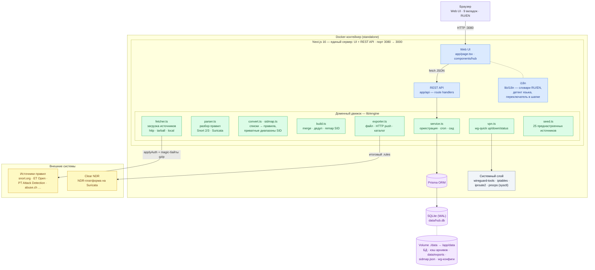
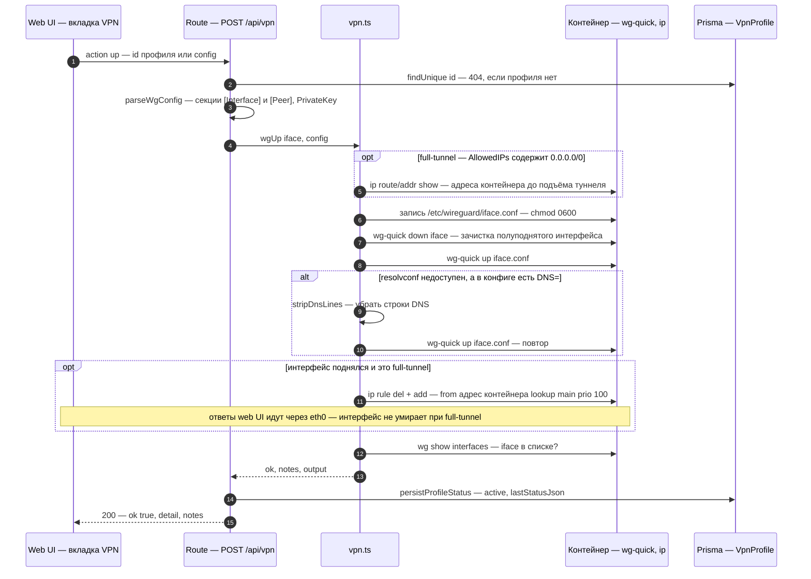
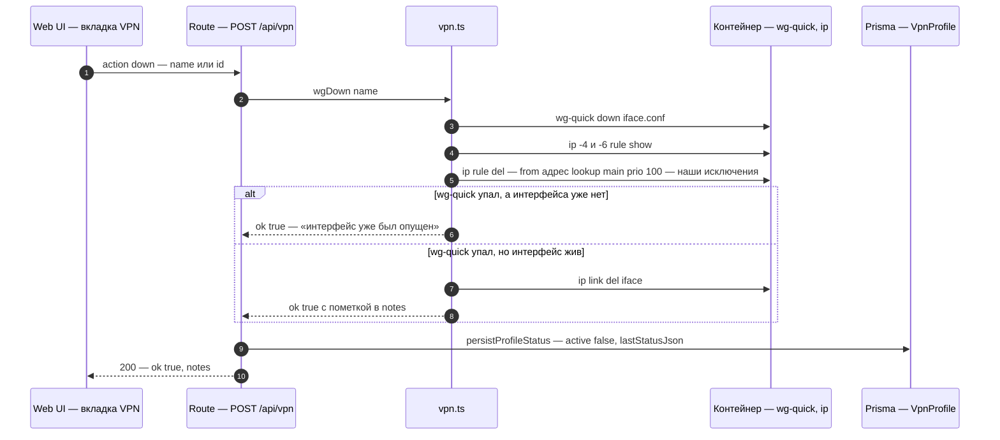
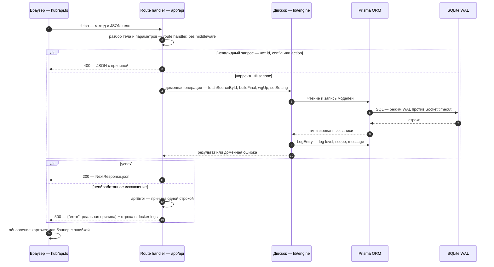

<p align="center">
  
</p>

# Архитектура NDR Rules Hub

**English version → [architecture.en.md](architecture.en.md)** · README: [README.md](README.md) · [README.en.md](README.en.md)

Документ описывает устройство системы: компоненты, модель данных, конвейеры обработки
и качества правил, механику загрузки, дедупликации и экспорта, VPN-слой, интерфейс и локализацию.

---

## 1. Обзор и назначение

**NDR Rules Hub** — вспомогательный сервис для NDR-платформы **Clear NDR** (Stamus Networks,
Suricata-базированной). Задача: автоматизировать полный цикл работы с наборами правил
Snort/Suricata — от источников до итогового файла, готового к импорту в Clear NDR.

Ключевые проблемы, которые закрывает система:

- **разрозненные источники** — официальные наборы Talos (snort.org), ET Open, PT Attack Detection,
  Quadrant, OISF, фиды abuse.ch и десятки конвертеров списков индикаторов живут по разным URL,
  с разной авторизацией и лимитами;
- **дубликаты и конфликты SID** — главная причина отказов импорта в Clear NDR
  («conflicting sid»);
- **несовместимость Snort → Suricata** — синтаксис Snort 3 (sticky-буферы, `soid`, `file`,
  inline-модификаторы) ломает загрузку в Suricata;
- **ручной труд** — без сервиса обновление правил — это ручное скачивание, конвертация и
  проверка по расписанию.

Принцип надёжности: **невалидированный набор не может попасть в Clear NDR** — итоговый файл
прогоняется через реальный движок Suricata (`suricata -T`), и экспорт блокируется до нуля ошибок.

## 2. Компонентная схема



Сервер один: Next.js обслуживает и UI, и API. «Бэкенда» отдельно не существует — если страница
открылась, API доступен. Данные переживают пересоздание контейнера за счёт volume `./data`.

## 3. Модель данных (Prisma / SQLite)

Схема — `prisma/schema.prisma`. Клиент генерируется с `binaryTargets = ["native",
"debian-openssl-3.0.x"]` (builder `oven/bun` ≠ runtime `node:22-bookworm-slim`).

| Модель | Назначение | Ключевые поля |
|---|---|---|
| `Source` | источник правил | `category` (ruleset / ip-list / domain-list / url-list), `kind` (url / tarball / local), `authType` (none / oinkcode / authkey / basic), `extraJson` (параметры конвертера и авторизации), `priority` (меньше = главнее), `status`, `badge`, `builtin` |
| `Rule` | правило конкретного источника | `sid`, `rev`, `action`, `proto`, `msg`, `raw`, `contentHash` (канонический SHA-1 без sid/rev/msg/metadata), `suricataOk`, `compatNotes`; уникальность `[sourceId, sid]` |
| `Build` | результат сборки | `statsJson` (статистика по источникам/дубликатам), `policyJson` (применённые политики), `fileName`, `sha256`, `sizeBytes`, `source` (manual / cron) |
| `Setting` | настройки (k-v) | oinkcode, стратегии дедупликации, privateSidStart, cron, параметры экспорта |
| `LogEntry` | журнал событий | `level` (ok/warn/error/success), `scope`, `message` |
| `VpnProfile` | сохранённый wg-quick конфиг | `name`, `config`, `active`, `lastStatusJson` |

Надёжность БД: режим **WAL** (против «Socket timeout» при параллельных запросах) и
авто-восстановление схемы: entrypoint сверяет штамп версии (`/app/data/.schema-version`) с
образцом из образа; при несовпадении старая база бэкапится в `data/hub.db.bak-<дата>` и
создаётся новая. Штамп считается только по моделям, поэтому правки генератора не пересоздают БД.

## 4. Конвейер обработки правил

```mermaid
flowchart LR
    subgraph SRC["Источники — 25 преднастроенных + свои"]
        direction TB
        SRC1["ruleset / tarball<br/>snort.org · ET Open ·<br/>PT AD · abuse.ch"]
        SRC2["локальные файлы<br/>и каталоги"]
        SRC3["списки индикаторов<br/>ip · domain · url"]
    end

    subgraph FETCH["Загрузка — fetcher.ts"]
        direction TB
        AUTH["applyAuth():<br/>oinkcode → reg-rules/файл/code,<br/>authkey · basic"]
        CHECK{"HTTP 200<br/>и gzip 1f 8b?"}
        CACHE[("кэш архивов<br/>data/cache<br/>cacheTtlMinutes")]
    end

    PARSE["Парсинг — parser.ts<br/>заголовок + опции, многострочные,<br/>pcre со скобками"]
    CONV["Конвертация — convert.ts · sidmap.ts<br/>IP-чанки · домены · URL,<br/>приватный диапазон SID, предохранители"]

    RULES[("Prisma · Rule — по источнику<br/>sid · rev · raw · contentHash<br/>suricataOk · compatNotes")]

    subgraph BUILD["Сборка — build.ts · service.ts"]
        direction TB
        MERGE["mergeSources(): конфликт SID →<br/>highest-rev / source-priority /<br/>renumber-private · dropIncompatible"]
        CONTENT["content-дедуп: SHA-1<br/>без sid/rev/msg/metadata/reference"]
        REMAP["remapToClearndrBlock():<br/>SID → свободный блок 1e9+,<br/>общая карта sidmap.json"]
        GATE{"гейт Clear NDR:<br/>конфликтные близнецы?"}
    end

    FINAL["renderFinalFile():<br/>clearndr-import.rules,<br/>sha256 + запись Build"]
    VALID["Валидация: статический фильтр<br/>совместимости (suricataOk);<br/>офлайн-пакет — цикл suricata -T"]
    EXPORT["Экспорт — exporter.ts<br/>файл · HTTP POST + Bearer ·<br/>каталог volume"]
    CRON["cron — node-cron<br/>обновление → сборка → экспорт"]
    LOG["LogEntry: error —<br/>сборка прервана"]

    SRC1 --> AUTH
    SRC2 --> AUTH
    SRC3 --> AUTH
    AUTH --> CHECK
    CHECK -- "да: текст правил" --> PARSE
    CHECK -- "да: список ip/domain/url" --> CONV
    CHECK -- "нет: HTML, лимит, ошибка" --> CACHE
    CACHE -- "fallback: ранее скачанный архив" --> PARSE
    PARSE --> RULES
    CONV --> RULES
    RULES --> MERGE
    MERGE --> CONTENT
    CONTENT --> REMAP
    REMAP --> GATE
    GATE -- "нет: 0 близнецов" --> FINAL
    GATE -- "да" --> LOG
    FINAL --> VALID
    VALID --> EXPORT
    CRON -.-> FETCH
    CRON -.-> BUILD
```



Шаги:

1. **Загрузка (`fetcher.ts`)** — по `kind`: HTTP(S)-URL, tar.gz-архив (скачивание → проверка
   magic-байтов → `tar -xzf` → сбор всех `.rules`), локальный путь/каталог.
2. **Парсинг (`parser.ts`)** — разбор заголовка и опций правила в структуру (SID, rev, msg,
   classtype, proto, направление), поддержка многострочных правил и pcre со скобками.
3. **Конвертация списков (`convert.ts`, `sidmap.ts`)** — IP/CIDR чанками по N адресов на SID,
   домены → DNS-правила, URL → HTTP-правила; SID из приватного диапазона (`privateSidStart`,
   стандарт 1 000 000–1 999 999); предохранители `perRule`/`maxRules`.
4. **Дедупликация и сборка (`build.ts`)** — устранение дубликатов по SID и по содержимому,
   разрешение конфликтов SID, опциональная перенумерация; фильтр совместимости.
5. **Валидация** — конвертер `scripts/s2x_convert.py` + цикл `suricata -T` (для офлайн-пакета
   `dist/`; онлайн-сборка применяет статический фильтр совместимости).
6. **Экспорт (`exporter.ts`)** — три режима: файл для ручного импорта, HTTP POST в Clear NDR
   (с Bearer-токеном), копирование в каталог (общий volume).

## 5. Конвейер качества правил

Принцип системы: **невалидированный набор не может попасть в Clear NDR**. Качество
обеспечивается пятью гейтами — каждый блокирует дефектный материал на своём этапе.

```mermaid
flowchart TD
    subgraph G1["Гейт 1 — Загрузка · fetcher.ts"]
        direction TB
        A1{"HTTP 200?"}
        A2{"тело = gzip 1f 8b?"}
        A3[("кэш архива<br/>+ cacheNote в журнал")]
        A1 -- "нет" --> A3
        A2 -- "нет: HTML-страница лимита<br/>или личного кабинета" --> A3
        A1 -- "да" --> A2
    end

    subgraph G2["Гейт 2 — Парсинг и совместимость · parser.ts"]
        direction TB
        B1{"строка = правило<br/>(заголовок + опции)?"}
        B2{"checkSuricataCompat():<br/>preproc · react · resp · rawbytes ·<br/>asn1 · dce_* · activate/dynamic ·<br/>sticky-буферы Snort 3?"}
        BN["suricataOk = false<br/>compatNotes"]
        B1 -- "да" --> B2
        B2 -- "несовместимо" --> BN
    end

    subgraph G3["Гейт 3 — Хранение · service.ts"]
        direction TB
        C1["дедуп по SID внутри источника —<br/>остаётся максимальный rev"]
        C2["contentHash: канонический SHA-1<br/>без sid/rev/msg/metadata/reference"]
        C1 --> C2
    end

    subgraph G4["Гейт 4 — Сборка · build.ts"]
        direction TB
        D1["политики: dropDisabledMsg ·<br/>dropIncompatible · content-дедуп"]
        D2["конфликт SID → стратегия:<br/>highest-rev / source-priority /<br/>renumber-private"]
        D3["remap в свободный clearndr-блок<br/>1 000 000 000+ — карта sidmap.json,<br/>формула md5 общая с python-конвейером"]
        D4{"конфликтные близнецы —<br/>совпадают после снятия<br/>sid и reference:*?"}
        D1 --> D2
        D2 --> D3
        D3 --> D4
    end

    G5{"Гейт 5 — Валидация движком<br/>suricata -T · офлайн-пакет dist/<br/>цикл: разбор лога →<br/>исключение/исправление → повтор"}
    FAIL["СБОРКА ПРЕРВАНА — файл не пишется,<br/>LogEntry: error"]
    OK["итоговый файл: 0 дубликатов,<br/>0 конфликтов SID, 0 ошибок Suricata<br/>+ sha256 и статистика в Build"]
    EXPORT["экспорт в Clear NDR разрешён"]

    G1 --> G2
    G2 --> G3
    G3 --> G4
    D4 -- "да" --> FAIL
    D4 -- "нет" --> G5
    G5 -- "0 ошибок" --> OK
    OK --> EXPORT
```



Что делает каждый гейт:

1. **Загрузка** — плохой ответ не сохраняется как архив: magic-байты gzip проверяются до записи
   на диск (HTML-страница лимита больше не ломает tar «not in gzip format»); при неудаче работа
   продолжается от ранее скачанного кэша с явной пометкой в журнале.
2. **Парсинг и совместимость** — правило разбирается только если строка совпала с шаблоном
   заголовка; несовместимые с Suricata конструкции помечаются `suricataOk = false` с перечнем
   причин в `compatNotes` (не молча отбрасываются).
3. **Хранение** — внутри источника остаётся только максимальный `rev` каждого SID; содержимое
   канонизируется (SHA-1 без sid/rev/msg/metadata/reference) для последующего content-дедупа.
4. **Сборка** — политики из настроек, разрешение конфликтов SID по стратегии, перенос SID в
   свободный clearndr-блок; **гейт конфликтных близнецов**: пары, совпадающие после снятия
   `sid` и `reference:*`, роняют импорт Clear NDR («conflicting SID in same source»), поэтому
   при их обнаружении сборка падает целиком — плохой файл не записывается.
5. **Валидация движком** — офлайн-пакет `dist/` проходит цикл `suricata -T` → разбор лога →
   исключение/исправление битых правил → повтор **до нуля ошибок**; онлайн-сборка применяет
   статический фильтр совместимости. Экспорт возможен только из набора, прошедшего гейты.

## 6. Загрузка: авторизация и лимиты snort.org

`fetcher.ts` поддерживает `authType`: `none`, `oinkcode`, `authkey` (query-параметр), `basic`
(логин/пароль в `extraJson`).

Проверено на практике поведение snort.org:

- каноническая форма авторизации — путь, а не query:
  `https://www.snort.org/reg-rules/<файл>.tar.gz/<oinkcode>` → редирект на реальный файл;
- ссылки личного кабинета `snort.org/downloads/registered/<файл>.tar.gz?oinkcode=…`
  **игнорируют query** и возвращают HTTP 200 + HTML-страницу;
- `applyAuth()` автоматически приводит любые известные формы к канонической
  (`downloads/registered|subscribed/…` → `reg-rules/<файл>/<oinkcode>`);
- **magic-байты gzip** (`1f 8b`) проверяются до записи на диск: HTML больше не сохраняется как
  архив и не ломает tar («not in gzip format»); при плохом ответе используется ранее скачанный
  архив (кэш) с пометкой `cacheNote`;
- лимиты: registered — не чаще раза в 15 минут; `cacheTtlMinutes` в `extraJson` исключает
  перекачивание; `422` = Invalid oinkcode, `403`/`429` = лимит; oinkcode в сообщениях об ошибках
  фигурирует только в виде отпечатка (`abcd…ef01`), полный код не логируется.

## 7. Дедупликация и стратегии SID

| Политика | Что делает |
|---|---|
| `dedupSidStrategy = highest-rev` | при конфликте SID остаётся правило с максимальным `rev` (по умолчанию) |
| `dedupSidStrategy = source-priority` | выигрывает источник с меньшим числом `priority` |
| `dedupSidStrategy = renumber-private` | конфликтующие SID переводятся в приватный диапазон |
| `dedupContent = true` | удаляет правила с одинаковым `contentHash` (канонический SHA-1 без sid/rev/msg/metadata), но разными SID |
| `dropIncompatible = true` | не включает в сборку конструкции, несовместимые с Suricata (preproc, keystore, replace, rawbytes…) |
| `dropDisabledMsg = true` | удаляет заглушки DELETED/DISABLED |

Статистика каждого шага (по источникам: загружено/в сборке/сброшено по SID/по содержимому/
несовместимых) пишется в `Build.statsJson` и отображается во вкладке «Сборка и экспорт».

## 8. WireGuard VPN слой

`vpn.ts` управляет туннелем внутри контейнера:

- редактирование и хранение wg-quick профилей (БД + `WG_CONFIG_DIR`);
- проверка синтаксиса (`wg-quick strip`), up/down, статус через `wg show` (пары, handshake,
  трафик);
- проверка окружения: `wg`, `wg-quick`, `/dev/net/tun`, `NET_ADMIN`, `sysctl`, запись
  `src_valid_mark` — карточки с тремя состояниями («доступно / недоступно / нет данных»);
- **full-tunnel не роняет web UI**: при подъёме конфига с `AllowedIPs = 0.0.0.0/0` добавляется
  policy-правило `ip rule add from <IP-контейнера> lookup main priority 100` (ответы web-сервера
  идут через eth0, остальной трафик — через туннель); при опускании правило снимается;
- `wg-quick` в образе пропатчен как в upstream (`ac74ed6`): запись `src_valid_mark` только если
  значение ещё не 1 (read-only `/proc/sys`).

### Последовательности up и down

Подъём туннеля — `POST /api/vpn {"action": "up", "id" | "config"}`:



Опускание туннеля — `POST /api/vpn {"action": "down"}`:



## 9. Web UI

Single-page приложение (Next.js App Router, клиентские компоненты) с 9 вкладками:

| Вкладка | Содержимое |
|---|---|
| Обзор | карточки статистики (источники, правила, последняя сборка, VPN), последние события |
| Источники | каталог 25 источников + свои, включение, загрузка по одному/всем, диалоги добавления/редактирования, разбор архивов snort.org |
| Правила | база правил с поиском по SID/msg/источнику и пагинацией |
| Сборка и экспорт | сборка, статистика по источникам, файлы в каталоге экспорта |
| WireGuard VPN | проверка окружения, редактор конфига, профили, активные интерфейсы |
| Настройки | oinkcode, политики дедупликации, экспорт, cron |
| Журнал | все события движка |
| Помощь | цели/задачи, конвейер, лимиты, диагностика — аккордеоны |
| О системе | разработчик, проект, благодарности, технологии с логотипами, логотип — аккордеоны |

Компоненты — shadcn/ui (Radix-примитивы) + Tailwind CSS; иконки — Lucide; логотипы технологий —
inline-SVG из simple-icons (`tech-logos.tsx`, CC0).

## 10. Локализация (RU/EN)

Слой — `src/lib/i18n/`:

```
detect.ts    Lang ('ru'|'en'), detectLang(browserStrings, stored), tr(), localeOf()
ru.ts        канонический словарь (≈180 строковых значений), export type Dictionary = typeof ru
en.ts        английский словарь, типизирован Dictionary → tsc не даёт ключам разъехаться
index.tsx    I18nProvider (useSyncExternalStore поверх localStorage) + useI18n()
```

Механика:

1. **SSR и гидрация** всегда рендерят русский (`<html lang="ru">`).
2. После монтирования `useSyncExternalStore` читает snapshot: сохранённый выбор
   (`localStorage['ndrh.lang']`) приоритетнее строк браузера `navigator.languages`
   (первый поддержанный язык: `ru*` → ru, `en*` → en; иначе `ru`).
3. **Переключатель RU/EN** в шапке вызывает `setLang()` → обновление snapshot, listeners,
   `localStorage`, `<html lang>` и `document.title`.
4. Шаблоны с переменными — плейсхолдеры `{n}` + `tr()`; богатый текст (аккордеоны «Помощь» и
   «О системе») — per-lang контент с лёгкой разметкой `**bold**`/`` `code` `` (компонент `Rich`).
5. Локализуются также единицы измерения (`fmtSize`: Б/КБ/МБ ↔ B/KB/MB) и формат дат
   (`localeOf`: `ru-RU` / `en-US`). Сообщения движка в журнале остаются русскими — это
   операционные данные.
6. Паритет языков контролируется тестами: равенство наборов ключей, пустых значений нет,
   плейсхолдеры совпадают, в EN нет кириллицы.

## 11. REST API

| Метод/путь | Назначение |
|---|---|
| `GET /api/health` | самодиагностика (БД, схема, файлы), всегда 200 |
| `GET /api/dashboard` | сводка для UI |
| `GET/POST /api/sources`, `PATCH/DELETE /api/sources/:id` | управление источниками |
| `POST /api/sources/:id/fetch`, `POST /api/fetch-all` | загрузка правил |
| `POST /api/build` | сборка (`{"export": true}` — с экспортом) |
| `GET/POST/PUT /api/export` | скачать / выгрузить / список файлов |
| `GET /api/rules` | база правил (sid, q, sourceId, page) |
| `GET/PUT /api/settings` | настройки |
| `GET/POST/PUT/DELETE /api/vpn` | WireGuard: статус, действия, профили |
| `GET /api/logs` | журнал |

Ошибки API возвращаются как `{"error": "…"}` с реальной причиной (не безликий HTTP 500) и
дублируются в контейнерные логи.

### Жизненный цикл запроса



## 12. Поставка и эксплуатация

- **Dockerfile** — многоэтапная сборка: builder (`oven/bun`) → standalone runtime
  (`node:22-bookworm-slim`) + `wireguard-tools`, `iptables`, `iproute2`, `openresolv`, `procps`.
  `outputFileTracingIncludes` гарантирует попадание Prisma-движков в standalone.
- **docker-compose.yml** — `cap_add: NET_ADMIN`, устройство `/dev/net/tun`, sysctls
  (`ip_forward`, `src_valid_mark`), volume `./data:/app/data`, порт 3080→3000.
- **Оркестрация** — `service.ts`: cron (node-cron, `TZ`) выполняет «обновление источников →
  сборка → экспорт»; тот же цикл доступен кнопкой «Полный цикл».
- **Тесты** — vitest, 84 теста: парсер, конвертеры, дедупликация, загрузчик (включая
  magic-байты и кэш), wg-quick, i18n.
