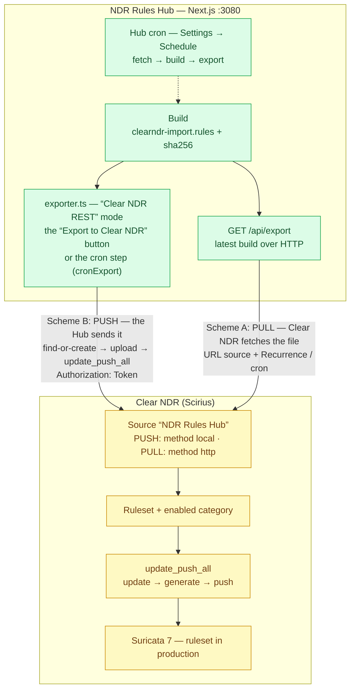
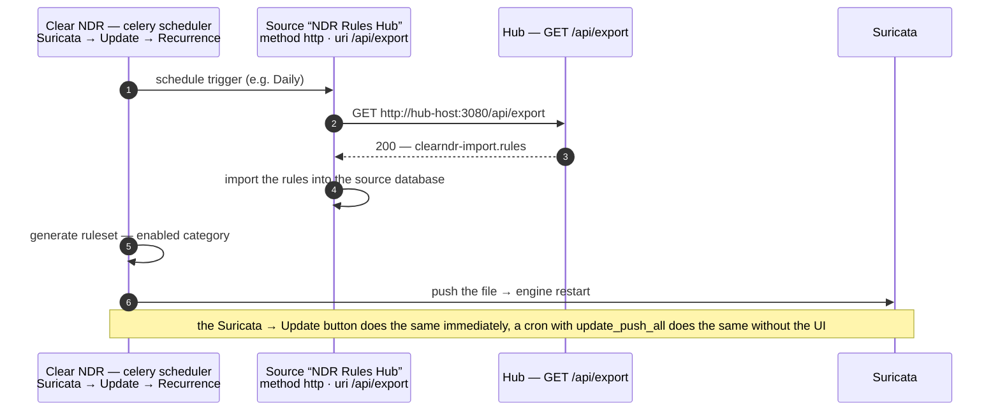
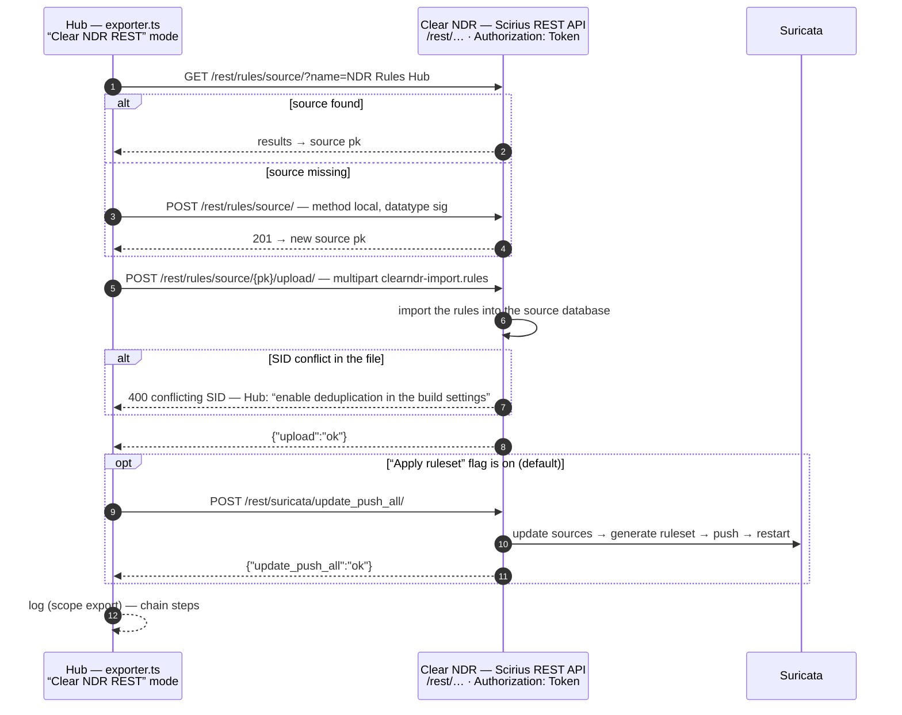

# Delivering and auto-updating rules to Clear NDR

Exact instructions for automatic delivery of the final ruleset from **NDR Rules Hub** to **Clear NDR** (Stamus Networks): where to get the API token, which commands to run on the Clear NDR side, how to enable auto-update, and how to verify everything without a production server.

> The reference was verified against the sources of the Clear NDR rules engine — [Scirius](https://github.com/StamusNetworks/scirius) (`rules/rest_api.py`, `suricata/rest_api.py`) and the Stamus Networks documentation (REST API, “Sources & Rulesets”).

---

## 1. Two delivery schemes

| | **Scheme A: PULL** (recommended) | **Scheme B: PUSH** |
|---|---|---|
| Who initiates | Clear NDR fetches the file from the Hub itself | The Hub pushes the file to Clear NDR itself |
| Network access | Clear NDR → Hub (HTTP 3080) | Hub → Clear NDR (HTTPS 443) |
| Configured in Clear NDR | a “HTTP URL” source + a schedule | nothing (the source is created automatically) |
| Configured in the Hub | nothing | “Clear NDR REST” mode, base URL, token |
| Auto-update | Clear NDR’s built-in scheduler | the Hub’s built-in cron (or a cron on Clear NDR) |
| When to choose | Hub and Clear NDR on the same network | the Hub is unreachable from Clear NDR (DMZ, NAT) |

Both schemes on one map (solid arrows — file delivery, dashed — schedule trigger):



In both schemes the file is the same — `clearndr-import.rules` (the final set after deduplication, SID remap into the 1e9+ block, and `suricata -T` validation).

---

## 2. The Clear NDR API token: purpose and where to get it

The Clear NDR (Scirius) REST API accepts two authentication methods: the web-UI session and a **token**. The token is required for all automated exchanges: scripts, cron, and the Hub’s “Clear NDR REST” export mode sign every request with the header:

```
Authorization: Token <token>
```

**Important:** exactly `Token`, not `Bearer`. Clear NDR does not accept the `Bearer` format — such a request returns HTTP 401. (The Hub lets you pick the authorization type in the export settings; the default is `Token`.)

### How to obtain the token

1. Log in to the Clear NDR web UI with an account that has rule-management permissions (administrator role, or groups with the `rules.source_edit` and `rules.ruleset_update_push` rights).
2. Open the user settings: **user menu in the header → User Settings → Edit Token**.
3. Click **Regenerate** (if a token already existed, it will be replaced).
4. Copy the token — 40 hex characters, e.g. `3064d9deadbeef36436daba5531e105123ec0fee`. The token is bound to your account: every API action is performed on its behalf and with its permissions.

> In some Scirius builds token management lives on a separate page, **Accounts → Token list** (`/accounts/token_list/`) — create a “token user” there; the result is the same.

### Verify the token (30 seconds)

```bash
curl -sk https://clearndr.local/rest/rules/source/?name=__probe__ \
     -H "Authorization: Token <token>"
```

- HTTP 200 with JSON like `{"count":0,"next":null,"previous":null,"results":[]}` — the token works;
- HTTP 401 `{"detail":"Invalid token."}` — the token is wrong or was regenerated;
- or run the ready-made script: `CLEAR_NDR_URL=https://clearndr.local CLEAR_NDR_TOKEN=<token> scripts/clearndr-check.sh` — it also lists existing sources and rulesets.

### Token security

- the token carries the full API permissions of your account: do not commit it, pass it via environment variables (`CLEAR_NDR_TOKEN`) or a 600-permission file;
- in the Hub the token is stored in the settings database (SQLite, `data/` directory) and entered into a password-type field in the UI;
- on staff rotation/leak — **Regenerate** invalidates the old token.

---

## 3. Scheme A: PULL — Clear NDR fetches the file from the Hub

The idea: the Hub already serves the final file over HTTP — `GET http://<hub>:3080/api/export`. In Clear NDR, create a Source of type “HTTP URL” pointing at that address, attach it to a Ruleset, and let Clear NDR’s built-in scheduler do the updating. The Hub stays a plain file provider: after every build the fresh file is served at the same address.

The data flow during a scheduled update:



### Prerequisites

- Clear NDR can reach the Hub (check from the Clear NDR server: `curl -sI http://<hub>:3080/api/export`);
- at least one build exists in the Hub (“Build & Export” tab → “Build”);
- the token has been obtained (section 2).

### Automatic setup (script)

The script is idempotent — it is safe to re-run:

```bash
cd scripts
CLEAR_NDR_URL=https://clearndr.local \
CLEAR_NDR_TOKEN=<token> \
HUB_URL=http://<hub-host>:3080/api/export \
./clearndr-setup-pull.sh
```

The script: verifies the file is reachable on the Hub → creates the “NDR Rules Hub” source (method=`http`, datatype=`sig`) → creates the “NDR Rules Hub” ruleset and attaches the source → enables the source’s category in the ruleset → calls `update_push_all` (rebuild + apply + Suricata restart).

### Manual setup (the same steps as curl commands)

```bash
export BASE=https://clearndr.local
export TOK="Authorization: Token <token>"

# 1. Create a URL source pointing at the Hub file
curl -sk -X POST "$BASE/rest/rules/source/" -H "$TOK" -H 'Content-Type: application/json' -d '{
  "name": "NDR Rules Hub",
  "method": "http",
  "datatype": "sig",
  "uri": "http://<hub-host>:3080/api/export",
  "use_sys_proxy": false,
  "comment": "NDR Rules Hub final ruleset"
}'
# → 201 {"pk": 7, ...}   remember the source pk

# 2. Create the ruleset and attach the source (or PATCH an existing one)
curl -sk -X POST "$BASE/rest/rules/ruleset/" -H "$TOK" -H 'Content-Type: application/json' -d '{
  "name": "NDR Rules Hub",
  "descr": "Ruleset from NDR Rules Hub",
  "sources": [7]
}'
# → 201 {"pk": 3, ...}   remember the ruleset pk

# 3. Find the source category (it appears after the first download)
curl -sk "$BASE/rest/rules/category/?source=7" -H "$TOK"
# → {"results":[{"pk": 12, "name": "NDR Rules Hub Sigs", ...}]}

# 4. Enable the category in the ruleset
curl -sk -X POST "$BASE/rest/rules/category/12/enable/" -H "$TOK" \
     -H 'Content-Type: application/json' -d '{"ruleset": 3, "comment": "NDR Rules Hub"}'

# 5. Apply: rebuild the ruleset, push to Suricata, restart the engine
curl -sk -X POST "$BASE/rest/suricata/update_push_all/" -H "$TOK" \
     -H 'Content-Type: application/json' -d '{"comment": "NDR Rules Hub"}'
# → 200 {"update_push_all": "ok"}
```

The same via the Clear NDR UI: **Sources → Add source** (Name, Source type: URL, Data type: “Individual Signatures file”) → **Rulesets → Add ruleset** (attach the source, tick the category) → **Suricata → Update**.

### Auto-update (the main question)

After the initial setup, Clear NDR automation is enabled in any of these ways:

**a) Clear NDR’s built-in schedule (recommended, no external tools).**
Clear NDR UI → **Suricata → Update**: enable “Reload” (update sources) and “Push” (rebuild and apply), then set a **Recurrence** — e.g. `Daily`. Clear NDR creates a recurring (celery) task: on schedule it downloads the fresh file from the Hub, imports the rules, rebuilds the ruleset and restarts Suricata. The one-shot **Update** button on the same page does it immediately.

**b) System cron (if you need your own schedule).**
On any server that can reach Clear NDR:

```cron
# daily at 05:10 — update sources and apply the ruleset
10 5 * * * curl -sk -X POST -H 'Authorization: Token <token>' -H 'Content-Type: application/json' -d '{}' https://clearndr.local/rest/suricata/update_push_all/ >/var/log/clearndr-update.log 2>&1
```

`update_push_all` is “all in one”: update (re-download URL sources) → generate (build the ruleset) → push (deploy to Suricata and restart).

**c) Full automation on the Hub side.**
Hub “Settings” → **Schedule (cron)**: enable the scheduler (`0 4 * * *` — daily at 04:00) and the “Export after build” flag. The Hub will then fetch sources → rebuild the file on cron, and the file is immediately available to Clear NDR at `/api/export`, where its own task (option a) or your cron (option b) picks it up.

### How to verify auto-update works

1. Change the ruleset in the Hub (add/remove a source), press “Full cycle” or wait for the cron.
2. In Clear NDR: **Sources → NDR Rules Hub** — the date/version is updated; **History** (`/rest/rules/history/`) — `update_source`/`update_push_all` entries from the token user.
3. In Suricata: check the ruleset statistics in the UI (Rulesets → rules_count increased).

---

## 4. Scheme B: PUSH — the Hub pushes to Clear NDR

The idea: the Hub itself performs the Scirius REST API chain — find/create the source → upload the file → apply the ruleset. Configured once in the Hub; nothing is required on the Clear NDR side (the source is created automatically at the first push).

### Setup in the Hub

The **“Settings” → Export to Clear NDR** tab:

| Field | Value |
|---|---|
| Mode | **Clear NDR REST (upload → apply)** |
| Clear NDR base URL | `https://clearndr.local` (root only, **no** `/rest`, no `/api`) |
| Authorization type | **Token** (native Clear NDR / Scirius) |
| API token | the token from section 2 |
| Source name in Clear NDR | `NDR Rules Hub` (created automatically if missing) |
| Apply ruleset after upload | enabled → `update_push_all` is called after every upload |

What the Hub does on export (the “Export to Clear NDR” button, the end of “Full cycle”, or the cron step):

```
GET  /rest/rules/source/?name=NDR Rules Hub   → find the source (create if missing)
POST /rest/rules/source/<pk>/upload/          → multipart upload of clearndr-import.rules
POST /rest/suricata/update_push_all/          → rebuild the ruleset and apply it to Suricata
```

The same chain as a sequence — with all branches (source exists/missing, SID conflict, the apply flag):



Every step is visible in the Hub’s “Logs” (scope `export`): `source “NDR Rules Hub” found (pk=7); file clearndr-import.rules uploaded and imported (6.2 MB); ruleset applied to Suricata (update_push_all: ok)`.

### Auto-update with the push scheme

- **Standard:** Hub “Settings” → enable **Schedule (cron)** + “Export after build”. The full cron cycle: fetch sources → build → push to Clear NDR → apply. Nothing else is needed.
- **Alternative:** `scripts/clearndr-push.sh` — the same push via curl when the file was built beforehand (e.g. by the offline pipeline `make_final_files.py`):

```bash
CLEAR_NDR_URL=https://clearndr.local CLEAR_NDR_TOKEN=<token> \
RULES_FILE=/path/clearndr-import.rules ./scripts/clearndr-push.sh
# → upload ok: 21834 rules, sha256=9f1c…
# → apply ok: {"update_push_all": "ok"}
```

Convenient in a cron on the Clear NDR server or next to it.

---

## 5. Verification and testing without a production Clear NDR

The repository ships a mock Clear NDR server that faithfully reproduces the REST API behaviour (Token auth, DRF pagination, multipart upload, the “conflicting SID” gate):

```bash
# 1. Start the mock (terminal 1)
python3 scripts/clearndr-mock-server.py --port 8080 --token mock-clearndr-token

# 2. Run the check and scripts against the mock (terminal 2)
CLEAR_NDR_URL=http://127.0.0.1:8080 CLEAR_NDR_TOKEN=mock-clearndr-token ./scripts/clearndr-check.sh

# 3. Push test with a file
CLEAR_NDR_URL=http://127.0.0.1:8080 CLEAR_NDR_TOKEN=mock-clearndr-token \
RULES_FILE=data/exports/clearndr-import.rules ./scripts/clearndr-push.sh

# 4. Pull setup against the mock (HUB_URL points at the Hub)
CLEAR_NDR_URL=http://127.0.0.1:8080 CLEAR_NDR_TOKEN=mock-clearndr-token \
HUB_URL=http://127.0.0.1:3000/api/export ./scripts/clearndr-setup-pull.sh

# 5. Inspect what the mock received
curl -s http://127.0.0.1:8080/_stats | python3 -m json.tool
```

In `_stats` look at `uploads[]` — file name, sha256, rule count. Compare the sha256 with the Hub build’s SHA-256 (shown in “Build & Export”) — they must match byte for byte.

The Hub’s “Clear NDR REST” mode is tested the same way: set the base URL to `http://127.0.0.1:8080`, the token to `mock-clearndr-token`, press “Export to Clear NDR”, then check `/_stats`.

---

## 6. REST API reference (endpoints in use)

Base: `https://<clearndr>/rest/` · Auth: `Authorization: Token <token>` · List responses are paginated: `{"count", "next", "previous", "results"}`.

| Method and path | Purpose | Body / response |
|---|---|---|
| `GET /rest/rules/source/` | list sources (`?name=` filter) | paginated list |
| `POST /rest/rules/source/` | create a source | `{"name","method":"http\|local","datatype":"sig\|sigs","uri?","use_sys_proxy?"}` → 201 |
| `POST /rest/rules/source/<pk>/upload/` | upload a file (method=local only; imports the rules immediately) | multipart: `file=@...rules` → `{"upload":"ok"}` |
| `POST /rest/rules/source/<pk>/update_source/` | update an http source (`?async=false` — synchronous) | `{"update":"ok"}` |
| `GET /rest/rules/ruleset/` | list rulesets | paginated list |
| `POST /rest/rules/ruleset/` | create a ruleset (`{"name","descr","sources":[pk]}`) | 201 |
| `PATCH /rest/rules/ruleset/<pk>/` | attach sources | `{"sources":[pk…]}` |
| `GET /rest/rules/category/?source=<pk>` | categories of a source | paginated list |
| `POST /rest/rules/category/<pk>/enable/` | enable a category in a ruleset | `{"ruleset": <pk>}` → `{"enable":"ok"}` |
| `POST /rest/suricata/update_push_all/` | **apply everything**: update sources → generate → push → Suricata restart | `{"update_push_all":"ok"}` |
| `GET /rest/rules/history/` | action log (audit) | paginated list |

---

## 7. Troubleshooting

| Symptom | Cause and fix |
|---|---|
| HTTP 401 `Invalid token.` | Wrong/regenerated token. Generate a new one (Edit Token → Regenerate). The header must be exactly `Authorization: Token …`, not Bearer |
| HTTP 404 on `/rest/…` | An extra path ended up in the base URL. In the Hub settings enter only the root (`https://clearndr.local`); `/rest` is appended automatically |
| “Clear NDR returned HTTP 400 … conflicting SID” | The file contains twin rules. Enable deduplication in the Hub (`dedupContent`, `dropIncompatible`) and rebuild — the builder removes conflicting pairs and remaps SIDs into the 1e9+ block before delivery |
| `update_push_all` failed after the upload | The file is uploaded but the ruleset was not applied (empty ruleset/category not enabled). Check the source attachment and the category, then repeat the `update_push_all` POST |
| The source updated but the ruleset has no new rules | The source category is not enabled in the ruleset: `POST /rest/rules/category/<pk>/enable/` or tick it in the Rulesets UI |
| HTTP 403 on every request | The account lacks `rules.source_edit` / `rules.ruleset_update_push` — use an administrator or grant the rights |
| Clear NDR cannot download `/api/export` | The Hub is unreachable / no build exists. Check `curl -sI http://<hub>:3080/api/export` from the Clear NDR server |
| Conflict with Stamus rules | The Hub’s SID block is 1 000 000 000…1 099 999 999. The Stamus Networks range is 1 000 000 000…1 002 899 999: do not enable Stamus TI custom rules in the same ruleset, or use a different block for converters |
| `https://` Hub with a self-signed certificate | Scirius verifies certificates on pull (`cert_verif` is read-only via the API) — serve the file over `http://` inside a trusted network or install a trusted certificate |

---

## 8. Deployment checklist

1. ☐ Token obtained (`Edit Token`), verified with `clearndr-check.sh` → HTTP 200.
2. ☐ Scheme chosen: PULL (§3) or PUSH (§4).
3. ☐ PULL: `clearndr-setup-pull.sh` finished 5/5, the source and ruleset exist, the category is enabled.
   PUSH: the Hub is set to “Clear NDR REST” with URL/token, and “Export to Clear NDR” reports “update_push_all: ok”.
4. ☐ Trial run: a build in the Hub → the file appears in Clear NDR (Sources → NDR Rules Hub → rules_count).
5. ☐ Auto-update enabled: recurrence in Clear NDR (a) and/or a cron `update_push_all` (b) and/or the Hub cron (c).
6. ☐ After a day: the Hub log (`export`) and Clear NDR History show update records.
7. ☐ The token is passed via environment variables/settings and never appears in logs or git.
