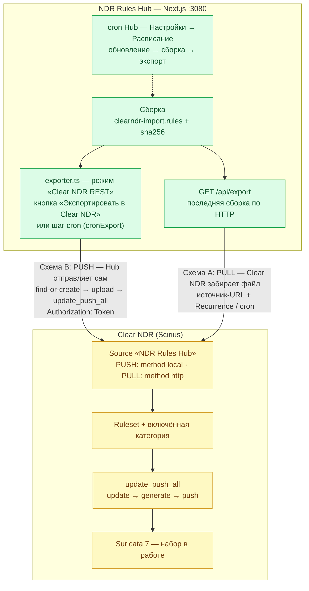
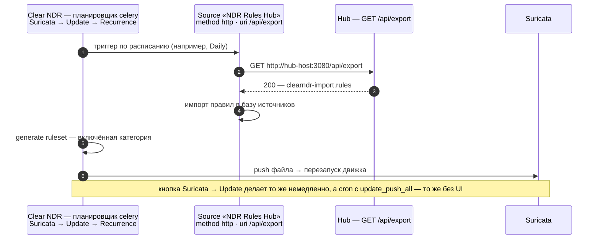
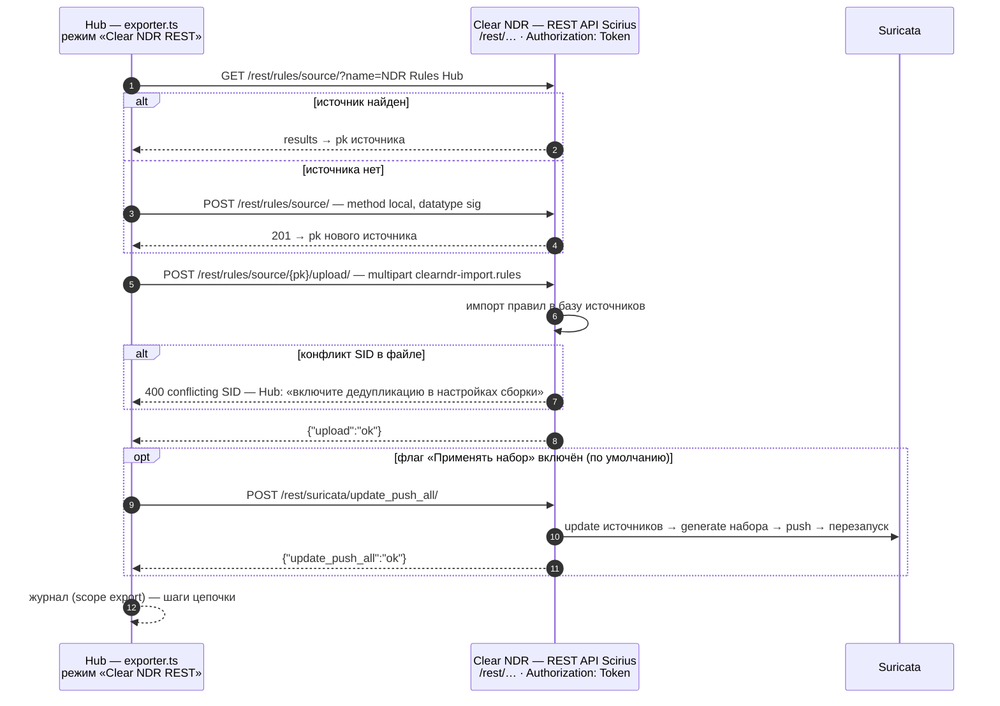

# Доставка и автообновление правил в Clear NDR

Точная инструкция по автоматической отправке итогового набора правил из **NDR Rules Hub** в **Clear NDR** (Stamus Networks): где взять API-токен, какие команды выполнить на стороне Clear NDR, как настроить автообновление и как всё это проверить без боевого сервера.

> Справочник проверен по исходникам движка правил Clear NDR — [Scirius](https://github.com/StamusNetworks/scirius) (`rules/rest_api.py`, `suricata/rest_api.py`) и документации Stamus Networks (REST API, раздел «Sources & Rulesets»).

---

## 1. Две схемы доставки

| | **Схема A: PULL** (рекомендуется) | **Схема B: PUSH** |
|---|---|---|
| Кто инициирует | Clear NDR забирает файл с Hub сам | Hub отправляет файл в Clear NDR сам |
| Доступ по сети | Clear NDR → Hub (HTTP 3080) | Hub → Clear NDR (HTTPS 443) |
| Что настраивается в Clear NDR | источник типа «HTTP URL» + расписание | ничего (источник создаётся автоматически) |
| Что настраивается в Hub | ничего | режим «Clear NDR REST», базовый URL, токен |
| Автообновление | встроенный планировщик Clear NDR | встроенный cron Hub (или cron на Clear NDR) |
| Когда выбирать | Hub и Clear NDR в одной сети | Hub недоступен с Clear NDR (DMZ, NAT) |

Обе схемы на одной карте (сплошные стрелки — доставка файла, пунктир — запуск по расписанию):



В обеих схемах файл один и тот же — `clearndr-import.rules` (итоговый набор после дедупликации, remap SID в блок 1e9+ и валидации `suricata -T`).

---

## 2. API-токен Clear NDR: зачем и где взять

REST API Clear NDR (Scirius) принимает два способа аутентификации: сессию веб-интерфейса и **токен**. Токен нужен для всего автоматического обмена: скрипты, cron и режим «Clear NDR REST» в Hub подписывают каждый запрос заголовком:

```
Authorization: Token <токен>
```

**Важно:** именно `Token`, а не `Bearer`. Формат `Bearer` Clear NDR не принимает — запрос вернёт HTTP 401. (В Hub тип авторизации выбирается в настройках экспорта; по умолчанию — `Token`.)

### Где получить токен

1. Войдите в веб-интерфейс Clear NDR под учётной записью, у которой есть права на управление правилами (роль администратора или группы с правами `rules.source_edit` и `rules.ruleset_update_push`).
2. Откройте настройки пользователя: **меню пользователя в шапке → User Settings → Edit Token**.
3. Нажмите **Regenerate** (если токен уже существовал — он будет заменён на новый).
4. Скопируйте токен — это 40 hex-символов, например `3064d9deadbeef36436daba5531e105123ec0fee`. Токен связан с вашей учётной записью: все действия через API выполняются от её имени и с её правами.

> В некоторых сборках Scirius управление токенами вынесено в отдельную страницу **Accounts → Token list** (`/accounts/token_list/`) — создайте «token user» там, результат тот же.

### Проверка токена (30 секунд)

```bash
curl -sk https://clearndr.local/rest/rules/source/?name=__probe__ \
     -H "Authorization: Token <токен>"
```

- HTTP 200 и JSON вида `{"count":0,"next":null,"previous":null,"results":[]}` — токен рабочий;
- HTTP 401 `{"detail":"Invalid token."}` — токен неверен/перегенерирован;
- или запустите готовый скрипт: `CLEAR_NDR_URL=https://clearndr.local CLEAR_NDR_TOKEN=<токен> scripts/clearndr-check.sh` — он же покажет имеющиеся источники и наборы.

### Безопасность токена

- токен = полные права вашей учётной записи на API: не пишите его в скрипты в git, передавайте через переменные окружения (`CLEAR_NDR_TOKEN`) или файл с правами 600;
- в Hub токен хранится в базе настроек (SQLite, каталог `data/`) и в UI вводится в поле типа password;
- при увольнении сотрудника/утечке — **Regenerate** старого токена делает его недействительным.

---

## 3. Схема A: PULL — Clear NDR сам забирает файл с Hub

Идея: итоговый файл уже отдаётся Hub по HTTP — `GET http://<hub>:3080/api/export`. В Clear NDR создаётся источник (Source) типа «HTTP URL» на этот адрес, привязывается к набору (Ruleset), а обновление выполняет штатный планировщик Clear NDR. Hub при этом остаётся «тупым» поставщиком файла: после каждой сборки новый файл уже лежит по тому же адресу.

Поток данных при плановом обновлении:



### Предпосылки

- Clear NDR умеет обращаться к Hub по сети (проверьте с сервера Clear NDR: `curl -sI http://<hub>:3080/api/export`);
- на Hub выполнена хотя бы одна сборка (вкладка «Сборка и экспорт» → «Собрать»);
- токен получен (раздел 2).

### Автоматическая настройка (скрипт)

Скрипт идемпотентен — можно запускать повторно:

```bash
cd scripts
CLEAR_NDR_URL=https://clearndr.local \
CLEAR_NDR_TOKEN=<токен> \
HUB_URL=http://<hub-host>:3080/api/export \
./clearndr-setup-pull.sh
```

Скрипт: проверит доступность файла на Hub → создаст источник «NDR Rules Hub» (method=`http`, datatype=`sig`) → создаст набор «NDR Rules Hub» и привяжет источник → включит категорию источника в наборе → вызовет `update_push_all` (пересборка + применение + перезапуск Suricata).

### Ручная настройка (те же действия curl-командами)

```bash
export BASE=https://clearndr.local
export TOK="Authorization: Token <токен>"

# 1. Создать источник-URL на файл Hub
curl -sk -X POST "$BASE/rest/rules/source/" -H "$TOK" -H 'Content-Type: application/json' -d '{
  "name": "NDR Rules Hub",
  "method": "http",
  "datatype": "sig",
  "uri": "http://<hub-host>:3080/api/export",
  "use_sys_proxy": false,
  "comment": "итоговый набор правил NDR Rules Hub"
}'
# → 201 {"pk": 7, ...}   запомните pk источника

# 2. Создать набор и сразу привязать источник (или PATCH существующего)
curl -sk -X POST "$BASE/rest/rules/ruleset/" -H "$TOK" -H 'Content-Type: application/json' -d '{
  "name": "NDR Rules Hub",
  "descr": "Набор из NDR Rules Hub",
  "sources": [7]
}'
# → 201 {"pk": 3, ...}   запомните pk набора

# 3. Найти категорию источника (категория появится после первой загрузки)
curl -sk "$BASE/rest/rules/category/?source=7" -H "$TOK"
# → {"results":[{"pk": 12, "name": "NDR Rules Hub Sigs", ...}]}

# 4. Включить категорию в наборе
curl -sk -X POST "$BASE/rest/rules/category/12/enable/" -H "$TOK" \
     -H 'Content-Type: application/json' -d '{"ruleset": 3, "comment": "NDR Rules Hub"}'

# 5. Применить: пересобрать набор, выложить в Suricata, перезапустить движок
curl -sk -X POST "$BASE/rest/suricata/update_push_all/" -H "$TOK" \
     -H 'Content-Type: application/json' -d '{"comment": "NDR Rules Hub"}'
# → 200 {"update_push_all": "ok"}
```

То же самое через UI Clear NDR: **Sources → Add source** (Name, Source type: URL, Data type: «Individual Signatures file») → **Rulesets → Add ruleset** (привязать источник, отметить категорию) → **Suricata → Update**.

### Автообновление (главный вопрос)

После первичной настройки автоматика Clear NDR включается любым из способов:

**a) Встроенное расписание Clear NDR (рекомендуется, без внешних инструментов).**
Интерфейс Clear NDR → меню **Suricata → Update**: включите «Reload» (обновить источники) и «Push» (пересобрать и применить), затем задайте **Recurrence** — например `Daily`. Clear NDR создаст рекуррентную задачу (celery): по расписанию он сам скачает свежий файл с Hub, импортирует правила, пересоберёт набор и перезапустит Suricata. Разовая кнопка **Update** на той же странице делает то же самое немедленно.

**b) Системный cron (если нужен свой график).**
На любом сервере с доступом к Clear NDR:

```cron
# ежедневно в 05:10 — обновить источники и применить набор
10 5 * * * curl -sk -X POST -H 'Authorization: Token <токен>' -H 'Content-Type: application/json' -d '{}' https://clearndr.local/rest/suricata/update_push_all/ >/var/log/clearndr-update.log 2>&1
```

`update_push_all` — «всё в одном»: update (скачать URL-источники заново) → generate (собрать набор) → push (выложить в Suricata и перезапустить).

**c) Полная автоматизация на стороне Hub.**
«Настройки» Hub → **Расписание (cron)**: включите планировщик (`0 4 * * *` — ежедневно в 04:00) и флаг «Экспортировать после сборки». Тогда Hub по cron: загрузит источники → пересоберёт файл → и он тут же будет доступен Clear NDR по `/api/export`, откуда тот заберёт его своей задачей (вариант a) или вашим cron-ом (вариант b).

### Как проверить, что автообновление работает

1. В Hub измените набор (добавьте/уберите источник), нажмите «Полный цикл» или дождитесь cron.
2. В Clear NDR: **Sources → NDR Rules Hub** — дата/версия обновилась; **History** (`/rest/rules/history/`) — записи `update_source`/`update_push_all` от имени токен-пользователя.
3. В Suricata: `suricata --dump-config | grep default-rule-path` / статистика набора в UI (Rulesets → rules_count вырос).

---

## 4. Схема B: PUSH — Hub сам отправляет в Clear NDR

Идея: Hub сам выполняет цепочку вызовов REST API Scirius — найти/создать источник → загрузить файл → применить набор. Настраивается один раз в Hub, не требует ничего со стороны Clear NDR (источник создаётся автоматически при первой отправке).

### Настройка в Hub

Вкладка **«Настройки» → Экспорт в Clear NDR**:

| Поле | Значение |
|---|---|
| Режим | **Clear NDR REST (upload → применить)** |
| Базовый URL Clear NDR | `https://clearndr.local` (корень, **без** `/rest` и без `/api`) |
| Тип авторизации | **Token** (штатный Clear NDR / Scirius) |
| API-токен | токен из раздела 2 |
| Имя источника в Clear NDR | `NDR Rules Hub` (создаётся автоматически, если нет) |
| Применять набор после загрузки | включено → после каждой загрузки вызывается `update_push_all` |

Что делает Hub при экспорте (кнопка «Экспортировать в Clear NDR», финал «Полного цикла» или шаг cron):

```
GET  /rest/rules/source/?name=NDR Rules Hub   → найти источник (создать при отсутствии)
POST /rest/rules/source/<pk>/upload/          → multipart-загрузка clearndr-import.rules
POST /rest/suricata/update_push_all/          → пересобрать набор и применить к Suricata
```

Та же цепочка в виде последовательности — со всеми ветками (источник есть/нет, конфликт SID, флаг применения):



Все шаги видны в «Журнале» Hub (scope `export`): `источник «NDR Rules Hub» найден (pk=7); файл clearndr-import.rules загружен и импортирован (6.2 МБ); набор применён к Suricata (update_push_all: ok)`.

### Автообновление при push-схеме

- **Штатно:** «Настройки» Hub → **Расписание (cron)** включить + «Экспортировать после сборки». Полный цикл по cron: загрузка источников → сборка → push в Clear NDR → применение. Больше ничего не нужно.
- **Альтернатива:** `scripts/clearndr-push.sh` — тот же push curl-ом, если файл собран заранее (например, офлайн-конвейером `make_final_files.py`):

```bash
CLEAR_NDR_URL=https://clearndr.local CLEAR_NDR_TOKEN=<токен> \
RULES_FILE=/path/clearndr-import.rules ./scripts/clearndr-push.sh
# → upload ok: 21834 правил, sha256=9f1c…
# → apply ok: {"update_push_all": "ok"}
```

Удобно в cron на сервере Clear NDR или рядом с ним.

---

## 5. Проверка и тестирование без боевого Clear NDR

В репозитории есть mock-сервер Clear NDR, точно воспроизводящий поведение REST API (Token-авторизация, пагинация DRF, multipart-upload, гейт «conflicting SID»):

```bash
# 1. Запустить mock (терминал 1)
python3 scripts/clearndr-mock-server.py --port 8080 --token mock-clearndr-token

# 2. Прогнать проверку и скрипты против mock (терминал 2)
CLEAR_NDR_URL=http://127.0.0.1:8080 CLEAR_NDR_TOKEN=mock-clearndr-token ./scripts/clearndr-check.sh

# 3. Push-тест файлом
CLEAR_NDR_URL=http://127.0.0.1:8080 CLEAR_NDR_TOKEN=mock-clearndr-token \
RULES_FILE=data/exports/clearndr-import.rules ./scripts/clearndr-push.sh

# 4. Pull-настройка против mock (HUB_URL указывает на Hub)
CLEAR_NDR_URL=http://127.0.0.1:8080 CLEAR_NDR_TOKEN=mock-clearndr-token \
HUB_URL=http://127.0.0.1:3000/api/export ./scripts/clearndr-setup-pull.sh

# 5. Посмотреть, что получил mock
curl -s http://127.0.0.1:8080/_stats | python3 -m json.tool
```

В `_stats` смотрите `uploads[]` — имя файла, sha256, число правил. Сверьте sha256 с файлом на Hub (`Сборка и экспорт` показывает SHA-256 сборки) — они обязаны совпадать байт в байт.

Режим «Clear NDR REST» в Hub тестируется так же: в настройках укажите базовый URL `http://127.0.0.1:8080`, токен `mock-clearndr-token`, нажмите «Экспортировать в Clear NDR» и проверьте `/​_stats`.

---

## 6. Справочник REST API (используемые эндпоинты)

База: `https://<clearndr>/rest/` · Авторизация: `Authorization: Token <токен>` · Ответы списков пагинированы: `{"count", "next", "previous", "results"}`.

| Метод и путь | Назначение | Тело / ответ |
|---|---|---|
| `GET /rest/rules/source/` | список источников (`?name=` — фильтр) | пагинированный список |
| `POST /rest/rules/source/` | создать источник | `{"name","method":"http\|local","datatype":"sig\|sigs","uri?","use_sys_proxy?"}` → 201 |
| `POST /rest/rules/source/<pk>/upload/` | загрузить файл (только method=local; импортирует правила сразу) | multipart: `file=@...rules` → `{"upload":"ok"}` |
| `POST /rest/rules/source/<pk>/update_source/` | обновить http-источник (`?async=false` — синхронно) | `{"update":"ok"}` |
| `GET /rest/rules/ruleset/` | список наборов | пагинированный список |
| `POST /rest/rules/ruleset/` | создать набор (`{"name","descr","sources":[pk]}`) | 201 |
| `PATCH /rest/rules/ruleset/<pk>/` | привязать источники | `{"sources":[pk…]}` |
| `GET /rest/rules/category/?source=<pk>` | категории источника | пагинированный список |
| `POST /rest/rules/category/<pk>/enable/` | включить категорию в наборе | `{"ruleset": <pk>}` → `{"enable":"ok"}` |
| `POST /rest/suricata/update_push_all/` | **применить всё**: update источников → generate → push → перезапуск Suricata | `{"update_push_all":"ok"}` |
| `GET /rest/rules/history/` | журнал действий (аудит) | пагинированный список |

---

## 7. Диагностика типовых ошибок

| Симптом | Причина и решение |
|---|---|
| HTTP 401 `Invalid token.` | Неверный/перегенерированный токен. Сгенерируйте заново (Edit Token → Regenerate). Заголовок — именно `Authorization: Token …`, не Bearer |
| HTTP 404 на `/rest/…` | В базовый URL попал лишний путь. В настройках Hub — только корень (`https://clearndr.local`); `/rest` дописывается автоматически |
| «Clear NDR вернул HTTP 400 … conflicting SID» | В файле есть правила-близнецы. В Hub включите дедупликацию (`dedupContent`, `dropIncompatible`) и пересоберите — сборщик удаляет конфликтные пары и переносит SID в блок 1e9+ до отправки |
| `update_push_all` вернул ошибку после upload | Файл загружен, но набор не применён (пустой ruleset/категория не включена). Проверьте привязку источника и категорию, затем повторите POST `update_push_all` |
| Источник обновился, но правил в наборе нет | Категория источника не включена в ruleset: `POST /rest/rules/category/<pk>/enable/` или отметьте её в UI Rulesets |
| HTTP 403 на все запросы | У учётной записи нет прав `rules.source_edit` / `rules.ruleset_update_push` — используйте администратора или добавьте права |
| Clear NDR не может скачать `/api/export` | Hub недоступен по сети/сборки нет. Проверьте `curl -sI http://<hub>:3080/api/export` с сервера Clear NDR |
| Конфликт с Stamus-правилами | SID-блок Hub — 1 000 000 000…1 099 999 999. Диапазон Stamus Networks — 1 000 000 000…1 002 899 999: не подключайте в один ruleset со «своими» правилами Stamus TI, либо используйте другой блок для конвертеров |
| `https://`-Hub с самоподписанным сертификатом | Scirius проверяет сертификаты при pull (`cert_verif` только для чтения в API) — отдавайте файл по `http://` внутри доверенной сети или выпустите доверенный сертификат |

---

## 8. Чек-лист внедрения

1. ☐ Токен получен (`Edit Token`), проверен `clearndr-check.sh` → HTTP 200.
2. ☐ Схема выбрана: PULL (§3) или PUSH (§4).
3. ☐ PULL: `clearndr-setup-pull.sh` отработал 5/5, источник и ruleset созданы, категория включена.
   PUSH: в Hub выбран режим «Clear NDR REST», указаны URL/токен, кнопка «Экспортировать в Clear NDR» дала «update_push_all: ok».
4. ☐ Тестовый прогон: сборка в Hub → файл появился в Clear NDR (Sources → NDR Rules Hub → rules_count).
5. ☐ Автообновление включено: recurrence в Clear NDR (a) и/или cron `update_push_all` (b) и/или cron Hub (c).
6. ☐ Через сутки проверены журнал Hub (`export`) и History Clear NDR — записи обновления есть.
7. ☐ Токен передаётся через переменные окружения/настройки, не светится в логах и git.
