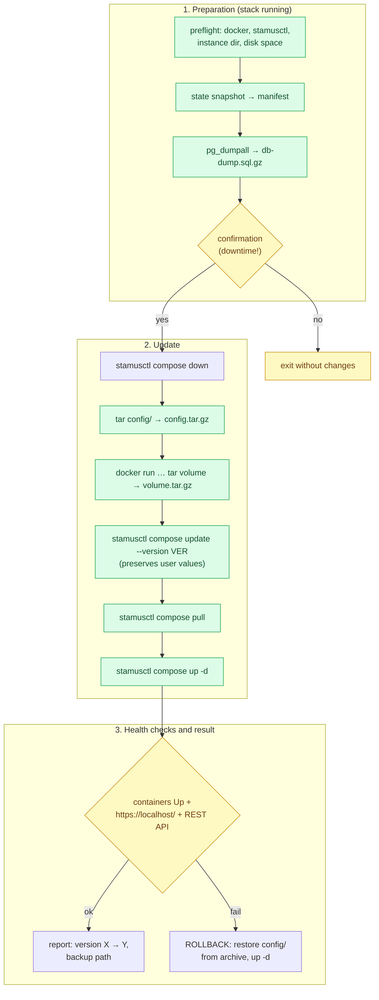
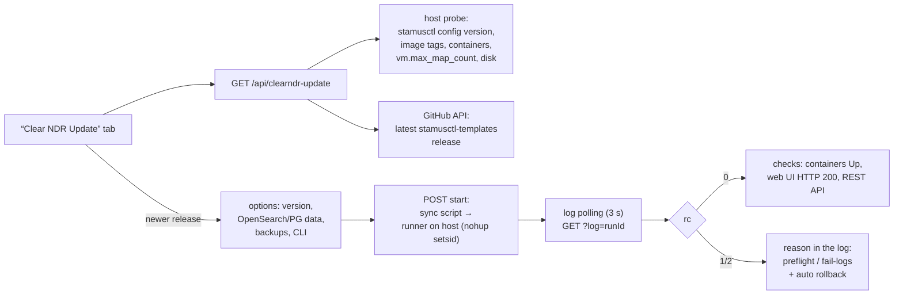

# Updating Clear NDR to a new version while preserving all settings

Exact instructions and script: how to upgrade an installed **Clear NDR Community** (Stamus
Networks, docker stack managed by `stamusctl`) to a new version without losing any settings:
rule sources, rulesets, enabled categories, SID remap, thresholds/suppressions, users and
API tokens, Suricata/nginx configuration and certificates.

> The procedure follows the official Stamus Networks documentation:
> [common-operations](https://docs.clearndr.io/docs/start/common-operations) (the standard upgrade
> path), [stamusctl compose update](https://docs.clearndr.io/docs/stamusctl/compose/update) (the
> template update command that preserves user values) and
> [github.com/StamusNetworks/stamusctl](https://github.com/StamusNetworks/stamusctl).
> Script: `scripts/clearndr-update.sh`. Verified against a mock stand (54/54: dry-run, full cycle,
> automatic rollback on failure, non-interactive runs).

---

## 1. How the update works and what is preserved

The update consists of two independent parts:

| Part | Command | What happens |
|---|---|---|
| `stamusctl` CLI | download a fresh binary from `dl.clearndr.io` | the stack management tool (optional, `--update-cli` flag) |
| Clear NDR stack | `stamusctl compose update --version VER` → `compose pull` → `compose up -d` | new template + fresh images; **stamusctl preserves your configuration values automatically** |

Key properties of the script (v3):

- **Status for every long step**: “⏳ label (sec)” overwrites a single terminal line;
  in non-interactive mode (cron) — `[WAIT] … (sec)` lines once a minute. Every step ends with
  “done (in Ns)”. No more “is it hanging?”.
- **Clean output and a compact log**: docker progress frames (Downloading/Extracting/Waiting)
  overwrite a single line on screen and **never reach the log** — the log contains only step
  start/finish, statuses, warnings and errors.
- **Data-compatibility analysis BEFORE stopping the stack**: if a component changes its major
  version (OpenSearch 2.x → 3.x, PostgreSQL 16 → 17), the script asks what to do: keep the data
  (with auto-rollback as the safety net), show manual conversion steps (OpenSearch events), or
  upgrade with clean data (for PostgreSQL — automatic volume recreation + dump restore).
  Cancelling at this point causes zero downtime.
- **mikrocata2selks (MikroTik) integration**: detection, snapshot of its files
  (`/usr/local/bin/mikrocata*.py`, systemd units, `tzsp*.netdev`), verification/restore of
  `suricata.interfaces` (tzsp0 etc.), post-update check of services/interfaces/suricata.
- **Universal customization preservation**: user files of `config/` that disappear during the
  template update are automatically restored from the archive.

The `compose update` command is officially documented as “merge existing configuration with new
template → preserves custom configuration values → maintains compatibility with existing data” —
settings configured via `stamusctl config set` (interfaces, HOME_NET, etc.) are carried over to
the new template automatically. Nevertheless the script additionally takes three backup levels:

| Level | What | When taken | File |
|---|---|---|---|
| 1. DB dump | `pg_dumpall` of PostgreSQL (service `db`, user `selks`): sources, rulesets, categories, SIDs, users, **API tokens** | **before the stack is stopped** (while the DB is alive) | `backups/db-dump-<ts>.sql.gz` |
| 2. `config/` directory | compose files, Suricata/nginx/fluentd configs, TLS certificates, stamusctl values | after the stack is stopped | `backups/config-<ts>.tar.gz` |
| 3. Docker volume | `<project>_db-data` — raw PostgreSQL data files | after the stack is stopped | `backups/volume-<...>_db-data-<ts>.tar.gz` |

Every run also produces `manifest-<ts>.txt` (versions, `stamusctl config get`, containers and
images before the update) and `SHA256SUMS-<ts>.txt`. The `config/` archive excludes OpenSearch
event data, pcap and logs (not settings; pass `--full-config` for a complete snapshot).

Process map:



---

## 2. Prerequisites

1. Clear NDR Community installed in **docker** (the canonical `stamusctl` way:
   `stamusctl compose init` creates the `config/` directory). Check:
   `stamusctl config list` shows your instance.
2. `stamusctl` in PATH. If missing, install it:
   ```bash
   wget https://dl.clearndr.io/stamusctl-linux-amd64
   chmod +x stamusctl-linux-amd64
   sudo mv stamusctl-linux-amd64 /usr/local/bin/stamusctl
   stamusctl version
   ```
3. Running Docker Engine (`docker ps` works) and a running stack (needed for the DB dump).
4. **Kernel: `vm.max_map_count` ≥ 262144** (OpenSearch requirement; check: `sysctl vm.max_map_count`).
   If it is lower, the opensearch container will not start after the update. Set it and make it persistent:
   ```bash
   sudo sysctl -w vm.max_map_count=262144
   echo 'vm.max_map_count=262144' | sudo tee /etc/sysctl.d/99-clearndr.conf
   ```
5. Enough space in the backup directory: ≥ 2 × size of `config/` + 2 GB, plus ≥ 5 GB on the docker
   storage root (`/var/lib/docker`) — the script checks both and refuses to continue when short.
6. Permissions: docker commands via the `docker` group or `sudo`.

---

## 3. Using the script

```bash
# 1) Show the plan without changing anything (always safe)
sudo ./scripts/clearndr-update.sh --dry-run

# 2) Update to the latest version (run from the instance dir — the parent of config/)
sudo ./scripts/clearndr-update.sh

# 3) Update to a specific version + also update stamusctl
sudo ./scripts/clearndr-update.sh --version 1.2.0 --update-cli

# 4) If not running from the instance directory
sudo ./scripts/clearndr-update.sh --instance /opt/clearndr

# 5) Automated (cron/CI): no questions, REST API check with a token
sudo ./scripts/clearndr-update.sh --yes \
     --token 3064d9deadbeef36436daba5531e105123ec0fee
```

Full flag reference:

| Flag | Default | Description |
|---|---|---|
| `--version VER` | `latest` (resolved from stamusctl-templates releases) | target template/stack version |
| `--instance DIR` | current directory | instance directory (parent of `config/`) |
| `--config-dir DIR` | `<instance>/config` | custom configuration directory |
| `--backup-dir DIR` | `<instance>/backups` | where to store backups |
| `--update-cli` | off | also update the `stamusctl` binary (dl.clearndr.io) |
| `--skip-db-dump` | off | skip the PostgreSQL dump (not recommended) |
| `--skip-volume` | off | skip copying the docker volume with DB data |
| `--full-config` | off | archive `config/` completely, including event data |
| `--url URL` | `https://localhost/` | web UI address for the health check |
| `--token TOKEN` | `$CLEAR_NDR_TOKEN` | token for the REST API check after the update |
| `--health-timeout S` | 300 | how many seconds to wait for the stack to become ready |
| `--yes` | off | do not ask for confirmation (accept `compose update` defaults) |
| `--no-rollback` | off | disable automatic rollback on failure |
| `--dry-run` | off | only show the plan and commands |
| `--opensearch-data keep\|wipe\|guide\|ask` | `ask` | what to do with event data on an OpenSearch major-version change: keep / wipe (volume saved to tar) / show conversion guide / ask |
| `--pg-strategy restore\|cancel\|ask` | `ask` | policy on a PostgreSQL major-version change: recreate the volume and restore the dump / cancel / ask |
| `--no-color` | off | disable colors (for cron/pipelines) |
| `--skip-mikrocata-check` | off | skip the mikrocata2selks post-update check |

> In interactive mode `stamusctl compose update` may ask for configuration values — Enter accepts
> the current/default values (as the documentation recommends). With `--yes` the script presses
> Enter on all prompts automatically.

---

## 4. What the script does step by step

1. **Preflight** — docker, stamusctl, curl, tar; instance directory; current version
   (`stamusctl config version`); target version (argument or the latest stamusctl-templates
   release via the GitHub API); free disk space check.
2. **State snapshot** → `manifest-<ts>.txt`: versions, `config get`, containers, images.
3. **DB dump** (the stack is still running): `pg_dumpall -U selks | gzip` →
   `db-dump-<ts>.sql.gz`. If the stack is stopped, the dump is skipped with a warning
   (not fatal).
4. **Plan + confirmation**: everything that will be done is printed; without `--yes` it asks
   `да/нет` (yes/no); in non-tty without `--yes` it refuses to run.
5. **Stop**: `stamusctl compose down --timeout 90` (graceful).
6. **Backup `config/`** → `config-<ts>.tar.gz` (excluding event data/pcap/logs).
7. **Volume backup** `<project>_db-data` via `docker run --rm … tar` →
   `volume-<...>-<ts>.tar.gz`.
8. **[optional] stamusctl update** — binary from `dl.clearndr.io` (amd64/arm64), replaced in the
   directory of the current one.
9. **Stack update**: `stamusctl compose update --version VER` (Enter = defaults on prompts)
   → `compose pull` (both run under a live status ticker; docker progress frames are filtered out).
10. **Stack start**:
    - re-analysis of compatibility from the actual new configuration (if target versions could
      not be determined in advance);
    - verification/restore of `suricata.interfaces` (critical for tzsp integrations);
    - with `--opensearch-data wipe`: the events volume is copied to tar, then removed;
    - **restoration of user `config/` files** that disappeared during the template update;
    - on a PostgreSQL major change: DB volume removal → db start → wait → dump restore;
    - `stamusctl compose up -d`.
11. **Health check** (up to `--health-timeout` seconds, live single-line status):
    `scirius`, `db`, `suricata`, `nginx`, `opensearch` containers in `Up` state (names look like
    `<base>-<service>-<seed>`); web UI returns 200/302; with a token set — `GET
    /rest/rules/source/` (HTTP 200 + the number of sources proves rule settings are intact);
    fresh errors in the scirius log are shown.
12. **mikrocata2selks post-check** (if detected): `mikrocataTZSP*.service` units, `tzsp*`
    interfaces, tzsp mentions in the suricata log.
13. **Result**: report “version X → Y”, backup path, next steps. Exit code 0.
14. **On failure — diagnostics + automatic rollback**: before rolling back, the script saves the
    status and logs of every stack container to `backups/fail-logs-<ts>/` (`compose down` would
    destroy the logs), prints the likely cause based on the opensearch log; then `compose down` →
    the current `config/` is moved to `config.failed-<ts>` → the `config-<ts>.tar.gz` archive is
    unpacked → `compose up -d` → verification that the previous stack is really up (on failure —
    an emergency recovery block is printed).
    Exit code 2. DB data (volume) is not touched during rollback — the dump for a targeted
    restore is stored nearby (see §6).

All messages are also written to `<backup-dir>/update-<ts>.log` (mode 600 — backups and logs
contain potentially secret configuration values).

---

## 5. Post-update verification (manual checklist)

1. ☐ Web UI opens, login works.
2. ☐ **Sources** — the “NDR Rules Hub” source is there with a fresh last-update date;
   **Rulesets** — `rules_count` matches expectations.
3. ☐ **Suricata → Update** — rebuild/apply completes without errors.
4. ☐ If the Hub is configured (PULL/PUSH, see [clearndr-integration.en.md](clearndr-integration.en.md))
   — the token works (`scripts/clearndr-check.sh` → HTTP 200) and rule delivery keeps working:
   after a cron cycle, History in Clear NDR shows fresh `update_source`/`update_push_all` entries.
5. ☐ After a day — the Clear NDR log is clean, the disk is not filling up (`docker system df`).

The script checks items 1–3 automatically; item 4 — with the token (`--token`).

---

## 6. Manual rollback and restore

The script rolls `config/` back automatically. PostgreSQL data (volume) is **not** touched —
for a targeted restore from the dump:

```bash
# 1. Bring up only the database
stamusctl compose up -d db

# 2. Restore the cluster from the dump (selks is the template user)
zcat backups/db-dump-<ts>.sql.gz | \
  docker exec -i "$(stamusctl compose ps -q db)" psql -U selks -d postgres

# 3. Restart the whole stack
stamusctl compose restart
```

Manual configuration directory restore (rollback without the script):

```bash
stamusctl compose down
mv config config.broken-<ts>
tar xzf backups/config-<ts>.tar.gz -C /path/to/instance
stamusctl compose up -d
```

> If `compose pull` already overwrote local image tags (with `latest` versions), pin the version
> for the rollback: `stamusctl compose update --version <old>` + `pull` + `up -d`.

---

## 7. Manual path without the script (minimal official way)

Exactly what the script does, in its minimal form — for “here and now” cases:

```bash
cd /path/to/instance            # parent of config/

# 0. Settings backup (mandatory minimum)
stamusctl config get > config-before-update.txt
docker exec "$(stamusctl compose ps -q db)" pg_dumpall -U selks | gzip > db-dump.sql.gz

# 1. Template + images update
stamusctl compose update            # or: stamusctl compose update --version 1.2.0
stamusctl compose pull

# 2. Restart
stamusctl compose up -d

# 3. Verification
stamusctl compose ps
stamusctl config version
curl -k -sI https://localhost/ | head -1
```

---

## 8. Troubleshooting

### 8.1. `dependency failed to start: container …-opensearch-… is unhealthy`

The most common update failure: compose waited for the opensearch health check
(`curl localhost:9200/_cluster/health`, a ~60–90 s window: `start_period 30s` + 3 retries × 10 s),
did not get a healthy state and refused to start the dependent services (scirius, dashboards,
fluentd depend on opensearch via `depends_on: service_healthy`). To pin down the exact cause:

```bash
cd /opt/ClearNDR                                   # instance directory
# 1) if the update was made with the script — the logs are already saved:
ls backups/fail-logs-*/                            # container status + logs at the moment of failure
grep -iE 'ERROR|Exception|Fatal' backups/fail-logs-*/config-opensearch-*.log | head

# 2) reproduce with the preserved new config (auto-rollback moves it to config.failed-<ts>):
stamusctl compose down
mv config config.rollback-tmp && mv config.failed-<ts> config
stamusctl compose up -d opensearch                 # start ONLY opensearch — no dependents
docker logs -f "$(docker ps -q --filter name=opensearch)"   # watch until the first error
# restore: stamusctl compose down && mv config config.failed-<ts> && mv config.rollback-tmp config
```

| What the opensearch log shows | Cause and solution |
|---|---|
| `The index [[…]] was created with version [1.x / 7.10] but the minimum compatible version is [2.0.0]` | OpenSearch 3.x (the current template ships 3.3.1) cannot read indices created by versions < 2.0.0. Options: (a) wipe the events volume and start with fresh indices — **rule settings in PostgreSQL are not lost** (below); (b) intermediate update to a template with OpenSearch 2.x + reindex |
| `max virtual memory areas vm.max_map_count … is too low` | `sysctl -w vm.max_map_count=262144` + persist to `/etc/sysctl.d/99-clearndr.conf` |
| `OutOfMemoryError` / `Cannot allocate memory` / exit code 137 | Not enough RAM for the 2 GB heap: `stamusctl config set opensearch.memory=1g`, then `stamusctl compose up -d` |
| `flood-stage watermark` / `disk usage exceeded` | Out of disk: `df -h /var/lib/docker`; remove old images (`docker image prune -f`) and/or indices (ISM deletes them after 15 days) |
| `failed to obtain node lock` | Data locked by another container/process: `docker ps -a \| grep opensearch`, remove duplicates |
| Log looks normal but health did not pass within ~90 s | Just a slow start (index recovery): wait for `docker ps` → `(healthy)`, then `stamusctl compose up -d` — compose will build the rest of the stack |

Wiping the events volume (event history is lost, settings are not; take a copy of the volume first
if needed):

```bash
docker volume ls | grep opensearch-data            # name looks like opensearch-data-<seed>
docker run --rm -v opensearch-data-<seed>:/src:ro -v /opt/ClearNDR/backups:/dst alpine \
    tar czf /dst/opensearch-data-<seed>-backup.tar.gz -C /src .   # copy (can be large)
docker volume rm opensearch-data-<seed>
stamusctl compose up -d                            # opensearch will create fresh indices
```

### 8.2. Other situations

| Symptom | Cause and solution |
|---|---|
| “Instance configuration directory not found” | The script was run outside the instance directory. Pass `--instance /opt/clearndr` or run from the parent of `config/` |
| “stamusctl not found” | Install the binary (§2) or set `STAMUSCTL_PATH=/path/to/stamusctl` |
| “Not enough space in …/backups” | Free up space or pass `--backup-dir` pointing to another disk |
| “Stack is not running — DB dump skipped” | Informational: the dump is taken only from a live stack. Start the stack or continue without the dump |
| `compose update` asks for configuration values | Normal: Enter accepts current/defaults. In cron use `--yes` |
| Health check does not pass within 300 s | Large images take long to download: increase `--health-timeout 600`. Check `stamusctl compose logs` |
| REST API does not return 200 | The token was regenerated/is invalid — get a fresh one (Edit Token → Regenerate, see section 2 of [clearndr-integration.en.md](clearndr-integration.en.md)) and re-run `scripts/clearndr-check.sh` |
| OpenSearch dashboards are “gone” after the update | Expected: Admin → System Settings → Kibana → “Reset SN dashboards”; export saved objects first (Stack Management → Saved Objects → Export) |
| Need to roll back the stamusctl CLI | Download the previous release from GitHub and replace the binary — this does not change the template version |

---

## 9. Update checklist

1. ☐ `stamusctl config list` — the instance is visible; `docker ps` — the stack is running.
2. ☐ `clearndr-update.sh --dry-run` — the plan looks correct, disk space is enough.
3. ☐ The downtime window is agreed (usually 2–10 minutes).
4. ☐ Run: `clearndr-update.sh [--version X.Y.Z] [--update-cli] --yes --token <token>`.
5. ☐ Exit code 0; report “X → Y”; backups in `backups/` (3 files + manifest + SHA256SUMS).
6. ☐ The manual checklist §5 is done (Sources/Rulesets/Suricata → Update/automatic delivery).
7. ☐ After a day: `docker image prune -f`, old `backups/config.failed-*` removed,
   the fresh `backups/` moved to long-term storage.

---

## 10. Updating from the NDR Rules Hub web UI

The **“Clear NDR Update”** tab wraps this script in the hub UI: version → release → options →
run → live log → result checks. The update itself is still performed by `clearndr-update.sh` —
**on the Clear NDR host**, from the hub container over SSH (recommended) or directly
(`local` mode).

### 10.1. How it works



- **Version detection** — `stamusctl config version` on the host (probe) plus the
  OpenSearch/PostgreSQL image tags from `config/`.
- **Latest release** — GitHub API `StamusNetworks/stamusctl-templates/releases/latest`
  (requested by the hub itself, no host access needed; offline option — the
  `CLEARNDR_RELEASES_JSON` env var pointing to a local JSON file).
- **Start** — the hub syncs the fresh script to the host (“Sync script” button and
  automatically before every run), creates a runner
  `<instance>/.hub-update-runs/<runId>/runner.sh` and launches it in the background
  (`nohup setsid`); the log and exit code live in that directory.
- **Progress** — the log tail is polled every 3 seconds; cancel sends SIGTERM to the
  runner process group.
- **Result** — rc 0/1/2 with an explanation (0 — success; 1 — preflight, stack untouched;
  2 — update failed, configuration rolled back) and stack state cards: containers,
  web UI (HTTP code), REST API with the token (number of rule sources in the DB).

### 10.2. One-time SSH setup (5 minutes)

1. Generate a key pair (if you don't have one) and add the public key on the Clear NDR host:
   ```bash
   # on the machine where the hub container runs (or anywhere):
   ssh-keygen -t ed25519 -f hub-update-key -N ''
   ssh-copy-id -i hub-update-key.pub root@clearndr-host
   ```
   For a non-root user, NOPASSWD sudo is required (docker/stamusctl need root):
   ```bash
   echo 'hub ALL=(ALL) NOPASSWD: ALL' | sudo tee /etc/sudoers.d/hub-update
   ```
2. In the hub: **“Clear NDR Update”** tab → “Clear NDR host connection” → `SSH` mode,
   host/port/user, private key (PEM) → **Save**.
3. **Test connection** — runs the probe (version, preflight, containers).
4. **Sync script** — places `clearndr-update.sh` on the host
   (`/opt/ClearNDR/clearndr-update.sh` by default).

### 10.3. Tab layout

| Block | What it shows |
|---|---|
| Version | installed (`stamusctl config version`), latest release, OpenSearch/PostgreSQL tags, stamusctl version; “update available” / “up to date” badge |
| Host preflight | `vm.max_map_count` (≥ 262144), free memory (≥ 3 GB), docker disk space (≥ 5 GB), mikrocata2selks integration |
| Stack state | containers (`docker ps`), web UI, REST API — the same data the script verifies after an update |
| Options | target version (empty = latest), OpenSearch data (`keep`/`wipe`), PostgreSQL strategy (`restore`), `--update-cli`, `--skip-db-dump`, `--skip-volume`, `--full-config`, `--skip-mikrocata-check`, health wait limit |
| Log | live run log with duration and an “Abort” button; after completion — rc explanation |
| History | UI-started runs: mode, time, rc, log |

> The “Start update” button is enabled only when a newer release is found and the host probe
> passes. A confirmation dialog with the plan precedes the run (downtime 2–10 minutes).

### 10.4. Local mode

Runs the script directly from the hub container (`spawn` detached, log under
`/app/data/clearndr-update/runs/`). It works only when the hub container can access Docker
(socket + CLI + stamusctl) and the instance directory, and the Clear NDR URL is reachable
from the container (e.g. `https://172.17.0.1/`). Use SSH for a typical install — it requires
no changes to the hub's docker-compose.

### 10.5. Hub environment variables

| Variable | Purpose |
|---|---|
| `CLEARNDR_UPDATE_SCRIPT` | path to the script inside the hub container (default `/app/scripts/clearndr-update.sh` — already in the image) |
| `CLEARNDR_RELEASES_JSON` | path to a local JSON `{ "tag_name": "v1.2.3", … }` instead of the GitHub API call (offline / closed perimeter) |
