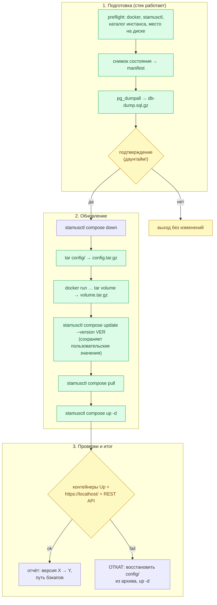
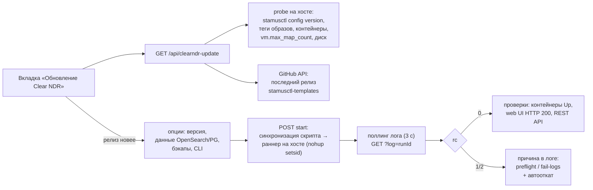

# Обновление Clear NDR на новую версию с сохранением всех настроек

Точная инструкция и скрипт: как обновить установленный **Clear NDR Community** (Stamus Networks,
docker-стек под управлением `stamusctl`) на новую версию, не потеряв ни одной настройки: источники
правил, наборы (rulesets), включённые категории, remap SID, пороги/подавления, пользователей и
API-токены, конфигурацию Suricata/nginx и сертификаты.

> Процедура основана на официальной документации Stamus Networks:
> [common-operations](https://docs.clearndr.io/docs/start/common-operations) (штатный путь обновления),
> [stamusctl compose update](https://docs.clearndr.io/docs/stamusctl/compose/update) (команда
> обновления шаблона с сохранением пользовательских значений) и
> [github.com/StamusNetworks/stamusctl](https://github.com/StamusNetworks/stamusctl).
> Скрипт: `scripts/clearndr-update.sh`. Проверен на мок-стенде (54/54: dry-run, полный цикл,
> автооткат при сбое, работа без терминала).

---

## 1. Как устроено обновление и что сохраняется

Обновление состоит из двух независимых частей:

| Часть | Команда | Что происходит |
|---|---|---|
| CLI `stamusctl` | скачать свежий бинарь с `dl.clearndr.io` | инструмент управления стеком (по желанию, флаг `--update-cli`) |
| Стек Clear NDR | `stamusctl compose update --version VER` → `compose pull` → `compose up -d` | новый шаблон + свежие образы; **пользовательские значения конфигурации stamusctl сохраняет автоматически** |

Ключевые свойства скрипта (v3):

- **Статус каждого долгого шага**: «⏳ подпись (сек)» перезаписывает одну строку терминала;
  в неинтерактивном режиме (cron) — строки `[WAIT] … (сек)` раз в минуту. Итог шага —
  «готово (за Nс)» — всегда печатается. Не видно «завис или нет» — больше не проблема.
- **Чистый вывод и компактный лог**: кадры прогресса docker (Downloading/Extracting/Waiting)
  перезаписывают одну строку на экране и **не попадают в лог** — лог содержит только
  начало/завершение шагов, статусы, предупреждения и ошибки.
- **Анализ совместимости данных ДО остановки стека**: если компонент меняет мажорную версию
  (OpenSearch 2.x → 3.x, PostgreSQL 16 → 17), скрипт спрашивает, что делать: сохранить данные
  (с риском автоотката), показать шаги ручной конвертации (события OpenSearch) или
  обновиться с чистыми данными (для PostgreSQL — автоматическое пересоздание тома +
  восстановление из дампа). Отмена на этом шаге — без простоя.
- **Интеграция mikrocata2selks (MikroTik)**: обнаружение, снапшот её файлов
  (`/usr/local/bin/mikrocata*.py`, systemd-юниты, `tzsp*.netdev`), проверка/восстановление
  `suricata.interfaces` (tzsp0 и др.), пост-проверка служб/интерфейсов/suricata.
- **Универсальное сохранение кастомизаций**: пользовательские файлы `config/`, исчезнувшие
  при обновлении шаблона, автоматически восстанавливаются из архива.

Команда `compose update` официально документирована как «merge existing configuration with new
template → preserves custom configuration values → maintains compatibility with existing data» —
то есть настройки, заданные через `stamusctl config set` (интерфейсы, HOME_NET и т.п.), переносятся
в новый шаблон сами. Тем не менее скрипт дополнительно снимает три уровня бэкапа:

| Уровень | Что | Когда снимается | Файл |
|---|---|---|---|
| 1. Дамп БД | `pg_dumpall` PostgreSQL (сервис `db`, пользователь `selks`): источники, наборы, категории, SID, пользователи, **API-токены** | **до остановки стека** (пока БД жива) | `backups/db-dump-<ts>.sql.gz` |
| 2. Каталог `config/` | compose-файлы, конфиги Suricata/nginx/fluentd, TLS-сертификаты, значения stamusctl | после остановки стека | `backups/config-<ts>.tar.gz` |
| 3. Docker volume | `<project>_db-data` — сырые файлы данных PostgreSQL | после остановки стека | `backups/volume-<...>_db-data-<ts>.tar.gz` |

Плюс в каждом прогоне создаётся `manifest-<ts>.txt` (версии, `stamusctl config get`, список
контейнеров и образов до обновления) и `SHA256SUMS-<ts>.txt`. Исключения из архива `config/` —
данные событий OpenSearch, pcap и логи (это не настройки; полный снимок — флаг `--full-config`).

Карта процесса:



---

## 2. Предусловия

1. Установка Clear NDR Community в **docker** (канонический способ через `stamusctl`:
   `stamusctl compose init` создаёт каталог `config/` рядом с данными). Проверка:
   `stamusctl config list` показывает ваш инстанс.
2. `stamusctl` в PATH. Если нет — установить:
   ```bash
   wget https://dl.clearndr.io/stamusctl-linux-amd64
   chmod +x stamusctl-linux-amd64
   sudo mv stamusctl-linux-amd64 /usr/local/bin/stamusctl
   stamusctl version
   ```
3. Запущенный Docker Engine (`docker ps` работает) и работающий стек (для дампа БД).
4. **Ядро: `vm.max_map_count` ≥ 262144** (требование OpenSearch; проверка: `sysctl vm.max_map_count`).
   Если меньше — контейнер opensearch не стартует после обновления. Настроить и сделать постоянным:
   ```bash
   sudo sysctl -w vm.max_map_count=262144
   echo 'vm.max_map_count=262144' | sudo tee /etc/sysctl.d/99-clearndr.conf
   ```
5. Достаточно места в каталоге бэкапов: ≥ 2 × размер `config/` + 2 ГБ и ≥ 5 ГБ на docker-хранилище
   (`/var/lib/docker`) — скрипт проверяет и откажется продолжать при нехватке.
6. Права: команды docker — из группы `docker` или через `sudo`.

---

## 3. Использование скрипта

```bash
# 1) Посмотреть план, ничего не меняя (безопасно выполнять всегда)
sudo ./scripts/clearndr-update.sh --dry-run

# 2) Обновить до последней версии (из каталога инстанса — родителя config/)
sudo ./scripts/clearndr-update.sh

# 3) Обновить до конкретной версии + заодно обновить stamusctl
sudo ./scripts/clearndr-update.sh --version 1.2.0 --update-cli

# 4) Если запуск не из каталога инстанса
sudo ./scripts/clearndr-update.sh --instance /opt/clearndr

# 5) Автоматически (cron/CI): без вопросов, с проверкой REST API по токену
sudo ./scripts/clearndr-update.sh --yes \
     --token 3064d9deadbeef36436daba5531e105123ec0fee
```

Полный набор флагов:

| Флаг | Значение по умолчанию | Описание |
|---|---|---|
| `--version VER` | `latest` (определяется по релизам stamusctl-templates) | целевая версия шаблона/стека |
| `--instance DIR` | текущий каталог | каталог инстанса (родитель `config/`) |
| `--config-dir DIR` | `<instance>/config` | нестандартный каталог конфигурации |
| `--backup-dir DIR` | `<instance>/backups` | куда складывать бэкапы |
| `--update-cli` | выкл | заодно обновить бинарник `stamusctl` (dl.clearndr.io) |
| `--skip-db-dump` | выкл | не снимать дамп PostgreSQL (не рекомендуется) |
| `--skip-volume` | выкл | не копировать docker volume с данными БД |
| `--full-config` | выкл | архивировать `config/` целиком, включая данные событий |
| `--url URL` | `https://localhost/` | адрес веб-интерфейса для health-check |
| `--token TOKEN` | `$CLEAR_NDR_TOKEN` | токен для проверки REST API после обновления |
| `--health-timeout S` | 300 | сколько секунд ждать готовности стека |
| `--yes` | выкл | не спрашивать подтверждение (принимать дефолты `compose update`) |
| `--no-rollback` | выкл | запретить автооткат при неудаче |
| `--dry-run` | выкл | только показать план и команды |
| `--opensearch-data keep\|wipe\|guide\|ask` | `ask` | что делать с данными событий при смене мажорной версии OpenSearch: сохранить / очистить (том в tar) / показать шаги конвертации / спросить |
| `--pg-strategy restore\|cancel\|ask` | `ask` | политика при смене мажорной версии PostgreSQL: пересоздать том и восстановить дамп / отменить / спросить |
| `--no-color` | выкл | отключить цвета (для cron/конвейеров) |
| `--skip-mikrocata-check` | выкл | пропустить пост-проверку интеграции mikrocata2selks |

> В интерактивном режиме `stamusctl compose update` может спросить значения конфигурации —
> Enter принимает текущие/дефолтные значения (так рекомендует документация). При `--yes`
> скрипт сам «нажимает Enter» на всех промптах.

---

## 4. Что делает скрипт по шагам

1. **Preflight** — docker, stamusctl, curl, tar; каталог инстанса; текущая версия (`stamusctl
   config version`); целевая версия (аргумент или последний релиз stamusctl-templates через
   GitHub API); проверка свободного места.
2. **Снимок состояния** → `manifest-<ts>.txt`: версии, `config get`, контейнеры, образы.
3. **Дамп БД** (стек ещё работает): `pg_dumpall -U selks | gzip` → `db-dump-<ts>.sql.gz`.
   Если стек остановлен — дамп пропускается с предупреждением (не фатально).
4. **План + подтверждение**: печатается всё, что будет сделано; без `--yes` спрашивает `да/нет`
   (в non-tty без `--yes` — отказ).
5. **Остановка**: `stamusctl compose down --timeout 90` (graceful).
6. **Бэкап `config/`** → `config-<ts>.tar.gz` (исключая данные событий/pcap/логи).
7. **Бэкап volume** `<project>_db-data` через `docker run --rm … tar` →
   `volume-<...>-<ts>.tar.gz`.
8. **[опц.] Обновление stamusctl** — бинарь с `dl.clearndr.io` (amd64/arm64), замена в каталоге,
   где стоит текущий.
9. **Обновление стека**: `stamusctl compose update --version VER` (Enter на промптах = дефолты)
   → `compose pull` (обе команды — под тикером статуса; кадры прогресса docker фильтруются).
10. **Запуск стека**:
    - повторный анализ совместимости по фактической новой конфигурации (если целевые версии
      не удалось определить заранее);
    - проверка/восстановление `suricata.interfaces` (критично для tzsp-интеграций);
    - при `--opensearch-data wipe`: копия тома событий в tar → удаление тома;
    - **восстановление пользовательских файлов `config/`**, исчезнувших при обновлении шаблона;
    - при смене мажорной версии PostgreSQL: удаление тома БД → запуск db → ожидание →
      восстановление дампа;
    - `stamusctl compose up -d`.
11. **Health-check** (до `--health-timeout` секунд, с живым статусом на одной строке):
    контейнеры `scirius`, `db`, `suricata`, `nginx`, `opensearch` в состоянии `Up`
    (имена вида `<base>-<service>-<seed>`); веб-интерфейс отвечает 200/302; при заданном токене —
    `GET /rest/rules/source/` (HTTP 200 + число источников = настройки правил на месте);
    просмотр свежих ошибок в журнале scirius.
12. **Пост-проверка интеграции mikrocata2selks** (если обнаружена): службы `mikrocataTZSP*.service`,
    интерфейсы `tzsp*`, упоминания tzsp в журнале suricata.
13. **Итог**: отчёт «версия X → Y», путь к бэкапам, next steps. Код выхода 0.
14. **При неудаче — диагностика + автооткат**: до отката скрипт сохраняет статус и журналы
    всех контейнеров стека в `backups/fail-logs-<ts>/` (после `compose down` журналы были бы
    потеряны), печатает вероятную причину по журналу opensearch; затем `compose down` →
    текущий `config/` переносится в `config.failed-<ts>` → распаковка архива
    `config-<ts>.tar.gz` → `compose up -d` → проверка, что прежний стек действительно
    поднялся (при неудаче — блок экстренного восстановления).
    Код выхода 2. Данные БД (volume) при откате не трогаются — дамп для
    точечного восстановления лежит рядом (см. §6).

Все сообщения дублируются в лог `<backup-dir>/update-<ts>.log` (права 600 — в бэкапах и логах
есть потенциально секретные значения конфигурации).

---

## 5. Проверка после обновления (ручной чек-лист)

1. ☐ Веб-интерфейс открывается, логин работает.
2. ☐ **Sources** — источник «NDR Rules Hub» на месте, дата последнего обновления источников
   свежая; **Rulesets** — `rules_count` соответствует ожидаемому.
3. ☐ **Suricata → Update** — пересборка/применение проходит без ошибок.
4. ☐ Если Hub настроен (PULL/PUSH, см. [clearndr-integration.md](clearndr-integration.md)) —
   токен действует (`scripts/clearndr-check.sh` → HTTP 200), автопоставка правил продолжает
   работать: после cron-цикла в History Clear NDR появились записи `update_source`/`update_push_all`.
5. ☐ Через сутки — журнал Clear NDR без ошибок, диск не переполнен (`docker system df`).

Скрипт проверяет пункты 1–3 автоматически; пункт 4 — по токену (`--token`).

---

## 6. Откат и восстановление вручную

Скрипт откатывает `config/` автоматически. Данные PostgreSQL (volume) он **не** трогает —
при необходимости точечного восстановления из дампа:

```bash
# 1. Поднять только БД
stamusctl compose up -d db

# 2. Восстановить кластер из дампа (пользователь selks — шаблонный)
zcat backups/db-dump-<ts>.sql.gz | \
  docker exec -i "$(stamusctl compose ps -q db)" psql -U selks -d postgres

# 3. Перезапустить стек целиком
stamusctl compose restart
```

Восстановление каталога конфигурации вручную (если нужен откат без скрипта):

```bash
stamusctl compose down
mv config config.broken-<ts>
tar xzf backups/config-<ts>.tar.gz -C /путь/к/инстансу
stamusctl compose up -d
```

> Если `compose pull` уже перезаписал локальные теги образов (при `latest`-версиях), для отката
> на конкретную версию укажите её: `stamusctl compose update --version <старая>` + `pull` + `up -d`.

---

## 7. Ручной вариант без скрипта (штатный минимум)

Ровно то, что делает скрипт, в минимальном виде — когда нужно «здесь и сейчас»:

```bash
cd /путь/к/инстансу            # родитель config/

# 0. Бэкап настроек (обязательный минимум)
stamusctl config get > config-before-update.txt
docker exec "$(stamusctl compose ps -q db)" pg_dumpall -U selks | gzip > db-dump.sql.gz

# 1. Обновление шаблона + образов
stamusctl compose update            # или: stamusctl compose update --version 1.2.0
stamusctl compose pull

# 2. Перезапуск
stamusctl compose up -d

# 3. Проверка
stamusctl compose ps
stamusctl config version
curl -k -sI https://localhost/ | head -1
```

---

## 8. Диагностика типовых ситуаций

### 8.1. `dependency failed to start: container …-opensearch-… is unhealthy`

Самая частая причина неудачного обновления: compose дожидался health-check opensearch
(`curl localhost:9200/_cluster/health`, окно ~60–90 с: `start_period 30s` + 3 попытки × 10 с),
не дождался и не стал запускать зависимые сервисы (scirius, dashboards, fluentd зависят от
opensearch через `depends_on: service_healthy`). Определить точную причину:

```bash
cd /opt/ClearNDR                                   # каталог инстанса
# 1) если обновление делали скриптом — журналы уже сохранены:
ls backups/fail-logs-*/                            # состояние + журналы контейнеров на момент сбоя
grep -iE 'ERROR|Exception|Fatal' backups/fail-logs-*/config-opensearch-*.log | head

# 2) воспроизведение с сохранённым новым конфигом (автооткат перемещает его в config.failed-<ts>):
stamusctl compose down
mv config config.rollback-tmp && mv config.failed-<ts> config
stamusctl compose up -d opensearch                 # поднять ТОЛЬКО opensearch — без зависимых
docker logs -f "$(docker ps -q --filter name=opensearch)"   # смотреть до первой ошибки
# вернуть как было: stamusctl compose down && mv config config.failed-<ts> && mv config.rollback-tmp config
```

| Что в журнале opensearch | Причина и решение |
|---|---|
| `The index [[…]] was created with version [1.x / 7.10] but the minimum compatible version is [2.0.0]` | OpenSearch 3.x (актуальный шаблон ставит 3.3.1) не читает индексы, созданные версией < 2.0.0. Варианты: (а) очистить volume событий и начать с чистыми индексами — **настройки правил в PostgreSQL не теряются** (ниже); (б) промежуточное обновление на шаблон с OpenSearch 2.x + переиндексация |
| `max virtual memory areas vm.max_map_count … is too low` | `sysctl -w vm.max_map_count=262144` + persist в `/etc/sysctl.d/99-clearndr.conf` |
| `OutOfMemoryError` / `Cannot allocate memory` / код 137 | Мало RAM под heap 2 ГБ: `stamusctl config set opensearch.memory=1g`, затем `stamusctl compose up -d` |
| `flood-stage watermark` / `disk usage exceeded` | Нет места: `df -h /var/lib/docker`; очистить старые образы (`docker image prune -f`) и/или индексы (ISM удаляет их с 15 дней) |
| `failed to obtain node lock` | Данные заняты другим контейнером/процессом: `docker ps -a \| grep opensearch`, убрать дубли |
| Журнал «нормальный», но health не успел за ~90 с | Просто медленный старт (восстановление индексов): подождать `docker ps` → `(healthy)`, затем `stamusctl compose up -d` — compose достроит остальное |

Очистка volume событий (история событий теряется, настройки — нет; предварительно можно
снять копию volume):

```bash
docker volume ls | grep opensearch-data            # имя вида opensearch-data-<seed>
docker run --rm -v opensearch-data-<seed>:/src:ro -v /opt/ClearNDR/backups:/dst alpine \
    tar czf /dst/opensearch-data-<seed>-backup.tar.gz -C /src .   # копия (может быть большой)
docker volume rm opensearch-data-<seed>
stamusctl compose up -d                            # opensearch создаст новые индексы
```

### 8.2. Прочие ситуации

| Симптом | Причина и решение |
|---|---|
| «Каталог конфигурации инстанса не найден» | Скрипт запущен не из каталога инстанса. Укажите `--instance /opt/clearndr` или запустите из родителя `config/` |
| «Не найден stamusctl» | Установите бинарь (§2) или задайте `STAMUSCTL_PATH=/путь/к/stamusctl` |
| «Мало места в …/backups» | Освободите место или укажите `--backup-dir` на другой диск |
| «Стек не запущен — дамп БД пропущен» | Информационное: дамп снимается только из живого стека. Запустите стек или продолжайте без дампа |
| `compose update` спросил значения конфигурации | Это штатно: Enter = принять текущие/дефолтные. В cron используйте `--yes` |
| Health-check не проходит за 300 с | Большие образы качаются долго: увеличьте `--health-timeout 600`. Проверьте `stamusctl compose logs` |
| REST API вернул не 200 | Токен перегенерирован/недействителен — возьмите свежий (Edit Token → Regenerate, см. раздел 2 [clearndr-integration.md](clearndr-integration.md)) и повторите `scripts/clearndr-check.sh` |
| После обновления «слетели» дашборды OpenSearch | Штатно: Admin → System Settings → Kibana → «Reset SN dashboards»; заранее экспортируйте saved objects (Stack Management → Saved Objects → Export) |
| Нужен откат CLI stamusctl | Скачайте предыдущий релиз с GitHub и замените бинарь — `compose update` версии шаблона это не меняет |

---

## 9. Чек-лист обновления

1. ☐ `stamusctl config list` — инстанс виден; `docker ps` — стек работает.
2. ☐ `clearndr-update.sh --dry-run` — план выглядит корректно, места на диске достаточно.
3. ☐ Окно даунтайма согласовано (обычно 2–10 минут).
4. ☐ Запуск: `clearndr-update.sh [--version X.Y.Z] [--update-cli] --yes --token <токен>`.
5. ☐ Код выхода 0; отчёт «X → Y»; бэкапы в `backups/` (3 файла + manifest + SHA256SUMS).
6. ☐ Ручной чек-лист §5 пройден (Sources/Rulesets/Suricata → Update/автопоставка).
7. ☐ Через сутки: `docker image prune -f`, старые `backups/config.failed-*` удалены,
   свежий `backups/` перенесён на долговременное хранение.

---

## 10. Обновление из web-интерфейса NDR Rules Hub

Вкладка **«Обновление Clear NDR»** оборачивает этот скрипт в UI хаба: версия → релиз →
опции → запуск → живой лог → проверки результата. Само обновление по-прежнему выполняет
`clearndr-update.sh` — **на хосте Clear NDR**, из контейнера хаба по SSH (рекомендуется)
или напрямую (режим `local`).

### 10.1. Как это работает



- **Определение версии** — `stamusctl config version` на хосте (probe) + теги образов
  OpenSearch/PostgreSQL из `config/`.
- **Последний релиз** — GitHub API `StamusNetworks/stamusctl-templates/releases/latest`
  (запрос идёт из хаба, хост не нужен; offline-вариант — переменная `CLEARNDR_RELEASES_JSON`
  с путём к локальному JSON).
- **Запуск** — хаб синхронизирует свежий скрипт на хост (кнопка «Синхронизировать скрипт»
  и автоматически перед каждым прогоном), создаёт раннер
  `<instance>/.hub-update-runs/<runId>/runner.sh` и запускает его в фоне
  (`nohup setsid`); лог и код выхода — в файлах этого каталога.
- **Прогресс** — хвост лога поллится каждые 3 секунды; отмена — SIGTERM группе процессов раннера.
- **Результат** — rc 0/1/2 с расшифровкой (0 — успех; 1 — preflight, стек не тронут;
  2 — неудача обновления, конфигурация откатена) и карточки состояния стека: контейнеры,
  web UI (HTTP-код), REST API по токену (число источников в базе).

### 10.2. Настройка SSH (5 минут, один раз)

1. Сгенерируйте пару ключей (если ещё нет) и добавьте публичный ключ на хосте Clear NDR:
   ```bash
   # на машине, где работает контейнер хаба (или где угодно):
   ssh-keygen -t ed25519 -f hub-update-key -N ''
   ssh-copy-id -i hub-update-key.pub root@clearndr-host
   ```
   Для не-root пользователя нужен NOPASSWD sudo (docker/stamusctl требуют root):
   ```bash
   echo 'hub ALL=(ALL) NOPASSWD: ALL' | sudo tee /etc/sudoers.d/hub-update
   ```
2. В хабе: вкладка **«Обновление Clear NDR»** → «Подключение к хосту» → режим `SSH`,
   хост/порт/пользователь, приватный ключ (PEM) → **Сохранить**.
3. **Проверить подключение** — выполнит probe (версия, предпроверки, контейнеры).
4. **Синхронизировать скрипт** — положит `clearndr-update.sh` на хост
   (`/opt/ClearNDR/clearndr-update.sh` по умолчанию).

### 10.3. Экран вкладки

| Блок | Что показывает |
|---|---|
| Версия | установленная (`stamusctl config version`), последний релиз, теги OpenSearch/PostgreSQL, версия stamusctl; бейдж «доступно обновление» / «актуально» |
| Предпроверки хоста | `vm.max_map_count` (≥ 262144), свободная память (≥ 3 ГБ), место под docker (≥ 5 ГБ), интеграция mikrocata2selks |
| Состояние стека | контейнеры (`docker ps`), web UI, REST API — те же данные, что проверяет скрипт после обновления |
| Параметры | целевая версия (пусто = latest), данные OpenSearch (`keep`/`wipe`), стратегия PostgreSQL (`restore`), `--update-cli`, `--skip-db-dump`, `--skip-volume`, `--full-config`, `--skip-mikrocata-check`, лимит ожидания здоровья |
| Журнал | живой лог прогона с длительностью и кнопкой «Прервать»; после завершения — расшифровка rc |
| История | прогоны из UI: режим, время, rc, лог |

> Кнопка «Запустить обновление» активна, только когда найден более новый релиз и probe хоста
> прошёл. Перед запуском — диалог-подтверждение с планом (даунтайм 2–10 минут).

### 10.4. Режим local

Запускает скрипт прямо из контейнера хаба (`spawn` detached, лог в
`/app/data/clearndr-update/runs/`). Удобен, когда **хаб развёрнут в контейнере на самом хосте
Clear NDR**: в образ хаба уже входят docker CLI и stamusctl (amd64). Требуются монтирования
в docker-compose хаба:

```yaml
    volumes:
      - /var/run/docker.sock:/var/run/docker.sock   # управление стеком
      - /opt/ClearNDR:/opt/ClearNDR                 # путь на хосте = путь в контейнере
```

и доступный из контейнера `healthUrl` (например `https://172.17.0.1/`, не `localhost`).
Для типовой удалённой установки используйте SSH — он не требует никаких изменений
в docker-compose хаба.

### 10.5. Переменные окружения хаба

| Переменная | Назначение |
|---|---|
| `CLEARNDR_UPDATE_SCRIPT` | путь к скрипту внутри контейнера хаба (по умолчанию `/app/scripts/clearndr-update.sh` — уже в образе) |
| `CLEARNDR_RELEASES_JSON` | путь к локальному JSON `{ "tag_name": "v1.2.3", … }` вместо запроса к GitHub API (offline/закрытый контур) |

## 11. Повреждённая конфигурация: диагностика и восстановление (v4)

С версии v4 скрипт защищён от инцидента 09.11.2026, когда после сбойного обновления
в каталоге инстанса пропал `docker-compose.yaml`, а повторный запуск откатился из архива,
снятого уже с повреждённого `config/`.

### 11.1. Симптомы

```text
stamusctl compose down
ERROR Status: stat /opt/ClearNDR/.../config/docker-compose.yaml: no such file or directory, Code: 14
# или после ручного восстановления файла из шаблона 3.3.x:
ERROR Status: service "opensearch" refers to undefined network network: invalid compose project, Code: 15
```

Вторая ошибка — известный гэп шаблонов stamusctl-templates 3.3.x: сервисы ссылаются на сеть
`network`, но секция `networks:` в шаблоне не определена.

### 11.2. Восстановление: clearndr-repair-stack.sh

Отдельный скрипт (`scripts/clearndr-repair-stack.sh`, идёт в образе хаба):

```bash
sudo ./clearndr-repair-stack.sh                        # найти повреждённые инстансы в /opt/ClearNDR
sudo ./clearndr-repair-stack.sh --instance-dir /opt/ClearNDR/config/events-stack/opensearch_dashboards
sudo ./clearndr-repair-stack.sh --dry-run              # только показать план
sudo ./clearndr-repair-stack.sh --no-up                # не запускать стек
```

Что делает: находит инстансы без compose-файла → восстанавливает недостающие файлы из
лучшего источника (a: `config.failed-*/`, b: архивы `config-*.tar.gz` с проверкой содержимого,
c: созданный вручную `config/config/docker-compose.yaml`, который заодно уводит в карантин) →
дописывает секцию `networks` (external на фактическую docker-сеть, найденную по seed-суффиксу
контейнеров) → проверяет проект `docker compose config` → по флагу поднимает стек и ждёт
health-check opensearch с разбором журнала при сбое. Существующие файлы НЕ перезаписывает.

> Из контейнера хаба: `docker cp ndr-rules-hub:/app/scripts/clearndr-repair-stack.sh .`
> и запустить на хосте (режим local хаба не подходит — сам хаб обновлять нельзя).

### 11.3. Защита в clearndr-update.sh (v4)

| Механизм | Что делает |
|---|---|
| Preflight-восстановление | если `config/docker-compose.yaml` пропал — скрипт сам возвращает его и остальные файлы из `config.failed-*/` или архивов до любых изменений |
| Проверка `docker compose config` | до изменений и после `compose update`: проект обязан загружаться, иначе обновление прерывается/откатывается |
| Автопатч сетей | после `compose update` дописывает неопределённые сети (external на фактическую сеть стека по seed) |
| Бэкап-гейт | архив `config/` без compose-файла считается неполным — обновление прерывается ДО деструктивных шагов |
| Защита отката | свежий архив, снятый с уже повреждённого `config/`, заменяется старым полным архивом или `config.failed-*/` |

Вкладка «Обновление Clear NDR» показывает состояние конфигурации в блоке предпроверок
(«Конфигурация стека (docker compose)») и блокирует запуск обновления при повреждении,
подсказывая команду repair-скрипта.
